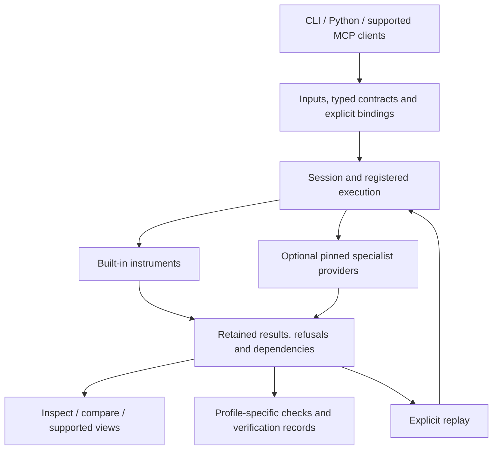

# Notations Engineering Terminal

**A programmable engineering workbench that connects measurements, models and execution in reproducible investigations.**

Developed by **Notation Systems Inc.**

[Quickstart](#quickstart) · [Operator manual](docs/OPERATOR_MANUAL.md) · [Architecture](docs/SYSTEM_ARCHITECTURE.md) · [Instruments](docs/INSTRUMENTS.md) · [Development](docs/DEVELOPMENT.md)

## From a calculation to an engineering record

Engineering work rarely ends with a number. A useful result needs its source data, model assumptions, units, uncertainty, software version and the checks that support it. Those details are easily lost as work moves between scripts, solvers, instruments and reports.

**Notations Engineering Terminal (NET)** brings them into a retained investigation. Engineers can run supported computational instruments, compose compatible operations, compare alternatives and inspect how a result was produced. Inputs, execution records, results and scoped checks stay connected, including accepted execution refusals and failed candidates. Reopening an investigation reads its history; replay creates a new execution.

Our near-term application focus is **polymer microfabrication and discrete manufacturing**. NET supplies the broader evidence, execution and instrumentation foundation for that work. Today's polymer profiles cover bounded injection-molding and extrusion-blow-molding studies; microfabrication-specific models and installed machine interfaces require their own implementation and qualification.

NET is useful when a calculation must survive review, revision or a handoff to another engineer. Its common operating loop is:

**Define the question → retain inputs → run a supported model → inspect and compare → revise → check.**

## Why use NET?

- **Keep the engineering context.** Supported contracts retain quantity meaning, units, frames, clocks, calibration references, uncertainty and source dependencies alongside results.
- **Use specialist tools through explicit interfaces.** Built-in instruments and pinned external providers share an investigation workflow while retaining their own algorithms and applicability limits.
- **Make iteration reviewable.** Save, reopen, compare and explicitly replay work without replacing the record of earlier attempts. Distinct evidence, execution, result and verification identities make those actions inspectable.
- **Compose repeatable workflows.** Typed graphs check declared interfaces. Bounded work orders retain acceptance checks and block dependent stages when prerequisites fail or remain indeterminate.
- **Give automation a defined scope.** Command-line, Python and supported MCP clients use registered operations and operator-supplied bindings. An agent's request does not create new execution or equipment-control authority.

NET is an actively developed research and engineering platform. The core local workflow is executable today; specialist providers have profile-specific setup and validation requirements. The [integration matrix](docs/INTEGRATION_COVERAGE.md) records those boundaries.

## Proto-Corpus and shared agent work

The [NCP knowledge and work system](docs/NCP_SYSTEM.md) adds a frozen source
catalog, metadata search and provenance resources over MCP, plus durable scoped
task exchange. Separate requester and worker clients share explicit source context.
Exact-task authorization and result review remain trusted host actions.

Use `ncp knowledge` to compile or search a catalog and generate a local MCP launcher,
and `ncp work` for explicit host administration. The optional
[`ncp evidence` profile](docs/NCP_EVIDENCE.md) adds hash-checked source passages
from selected text files and ZIP members, with exact citation locators.
The existing [`ncp corpus` profile](docs/CORPUS_RETRIEVAL.md) retains selected-source
sidecars and supports combined read-only inspection of operator-bound NCP records.
Catalog metadata, source bytes, candidate results and accepted evidence retain
distinct identities and authority. Discovery alone does not approve a task context.
The [system coherence guide](docs/NCP_SYSTEM_COHERENCE.md) records the integrated
profiles, source provenance and authority boundaries.

## Board refitting through MCP

The [Board refit profile](docs/BOARD_MCP_REFIT.md) exposes a complete bounded
parameter-change journey: preview dependencies, validate, recompute under a
host-selected grant, compare and retain an unreviewed candidate. It reuses the
System Board, semantic compiler, Session and Needle. The first supported profile
uses retained synthetic oscillator evidence. The [GaugeLink profile](docs/GAUGELINK_MCP_REFIT.md)
adds retained measurement uncertainty scenarios, preserves the original capture and
reuses unchanged results. Both retain candidates for independent review and grant
no physical control. [Implementation sequence](docs/NCP_GAUGELINK_IMPLEMENTATION.md).

## Quickstart

Use **Python 3.11 or newer** from the repository root. On Linux or macOS:

```sh
python3 -m venv .venv
source .venv/bin/activate
python -m pip install .

net doctor --profile core
net catalog
net start --output-dir results/first-use-001
```

For Windows setup, see the [platform-specific quickstart](docs/quickstart.md#install).

- `doctor` checks installed package and dependency metadata.
- `catalog` lists command surfaces and provider requirements without running them.
- `start` runs bounded synthetic oscillator, thermal-observer and atmospheric workflows, including retained-record inspection and a thermal replay.

Read `results/first-use-001/readiness.json` for the named checks and artifact paths. Use a fresh output directory for each run. The receipt establishes what that installation exercised; it is separate from external-provider or physical qualification.

### Keep a local investigation open

```sh
net workbench --output-dir results/workbench
```

Leave the service running, then use a second terminal with the same environment activated:

```sh
ciw health
ciw send session.get
ciw send analysis.stats
ciw send result.list
ciw send workspace.save
```

`analysis.stats` creates a new result. Save before stopping the service with Ctrl+C. Restarting the workbench reopens saved state without rerunning its numerical operations. The service binds to loopback by default.

The distribution is `computational-instrumentation-workbench`, the Python package is `ciw`, and the command-line entry points are `ncp`, its historical alias `net`, and `ciw`. The root install supplies the workbench; optional engines and imported instruments retain separate runtime requirements. See [installed tools](docs/RUN_NET.md) and [operator readiness](docs/OPERATOR_READINESS.md).

## Explore a manufacturing workflow

The polymer instrument connects retained sensor features, declared part tolerances, engineering reference calculations and a separate numerical audit. A synthetic example is available without external providers:

```sh
net polymer demo --process injection_molding --output-dir results/polymer-demo-001
net polymer summary results/polymer-demo-001
net polymer verify results/polymer-demo-001 --output results/polymer-audit-001.json
net polymer replay results/polymer-demo-001 --output-dir results/polymer-replay-001 --summary
```

Open `results/polymer-demo-001/report/report.html` to review the retained report. The example deliberately includes a nonconforming dimension: a completed workflow and a passing numerical audit can correctly retain a failed part-tolerance decision. Replay creates new occurrence identities while preserving the original run.

The current profiles support injection molding and extrusion blow molding, bounded cooling and pressure-arrival estimates, quantitative sensor-feature ingress and toy-plant control simulation. They prepare a deterministic copilot context; they do not establish automated root-cause diagnosis, live camera processing or machine actuation. Use the [polymer guide](docs/POLYMER_PROCESSING.md) for inputs, native calibration import, applicability and the installed qualification gate. [Fluid and material leakage accounting](docs/leakage.md) is a separate pinned-provider workflow.

### Other supported starting points

| Engineering task | Available workflow | Operating guide |
| --- | --- | --- |
| Analyze a recording | Statistics, spectra, explicit selections and retained analysis results | [Recording quickstart](docs/quickstart.md#analyze-a-retained-recording) |
| Study a measurement chain | Declared calibration, full joint covariance in supported profiles, and separate temperature-processing audits | [Covariance](docs/COVARIANCE.md), [temperature processing](docs/NET_AGENT_PROTOCOL.md#temperature-measurement-processing-profile) |
| Estimate thermal state | Bounded estimation from calibrated recordings with a held-out reference | [Measured thermal](docs/MEASURED_THERMAL.md) |
| Compare physical-model behavior | Bounded oscillator, impact, fluid, thermal and atmospheric examples | [Domain examples](docs/DOMAIN_EXAMPLES.md), [numerical comparisons](docs/EXTERNAL_NUMERICAL_COMPARISONS.md) |
| Organize repeatable execution | Typed workflow composition, explicit dependencies and bounded acceptance/repair stages | [Workflow algebra](docs/WORKFLOW_ALGEBRA.md), [work orders](docs/NET_PRODUCTION.md) |
| Test a reduced representation | Exact finite probability and intervention-preservation checks with retained counterexamples | [Finite preservation](docs/FINITE_REPRESENTATION_PRESERVATION.md) |
| Review hardware refurbishment | Asset histories, bench-data imports, repairs, costs and explicit release-review records | [Refurbishment operations](docs/REFURBISHMENT_OPERATIONS.md) |
| Inspect spatial and interactive systems | Selected geometry, BIM and engine-specific views and workflows | [Interactive simulation](docs/INTERACTIVE_SIMULATION.md), [instrument catalogue](docs/INSTRUMENTS.md) |

Each guide identifies the executable contract, required environment and remaining validation work. Availability in source does not by itself qualify a provider or installation for an engineering decision.

## How the system fits together



- **Contracts and composition** describe state, transformations, quantity meaning and compatible interfaces. The mathematical organizing principle is state, permitted change and preserved structure.
- **Session and execution** select registered operations, capture their dependencies and retain execution outcomes. Runtime bindings come from the operator rather than from saved workspace content.
- **Instruments and providers** own numerical algorithms, model assumptions, validity domains and runtime requirements. The monorepo co-locates imported public modules while preserving their package identities and licences.
- **Evidence and checks** make lineage, comparisons and scoped validation inspectable. A content hash identifies bytes; an independent check must establish its own stated property.
- **Clients and views** expose the retained investigation through terminal, local service and selected visualization/agent interfaces. A rendering or agent response does not replace the underlying scientific record.

NET is the public engineering workbench in the wider Notation Systems stack. Acquisition, canonical evidence admission, deployment policy and equipment interfaces retain separate responsibilities. The [stack map](docs/STACK.md), [architecture diagrams](docs/SYSTEM_ARCHITECTURE.md) and [protocol](docs/PROTOCOL.md) describe implemented connections and extension points.

### Mathematical foundations and optional proofs

NET makes selected mathematical ideas operational: typed serial/parallel composition, ordered covariance transport, declared invariant checks and exact finite representation-preservation tests. Each implementation has a stated domain. The [research foundations](docs/RESEARCH_FOUNDATIONS.md) distinguish established mathematics, architectural adaptations and project hypotheses.

For independently checkable computation, the optional [registered heat profile](docs/PROVED_HEAT.md) integrates the Scientific Computation Runtime with SP1. It binds a bounded integer calculation to the expected program and input/output commitments, then invokes a separate verifier. Proving requires the documented backend and guest setup; it is not part of the core quickstart.

A verified computation supports the registered program's claim under its assumptions. Calibration, physical model validity and permission to operate equipment require separate evidence. Reading a saved proof report performs no fresh verification. The retained heat profile exposes its inputs and outputs and makes no privacy claim; additional checker preparation is not automatically proof coverage.

## Status and operating boundaries

NET currently supports bounded research and engineering workflows with local persistence, explicit replay and retained failure history. Its scope is documented per instrument and integration:

- **Numerical evidence:** Reference comparisons and audits cover stated inputs, models and tolerances. They do not establish accuracy outside the exercised domain.
- **Measurement evidence:** Unknown uncertainty remains unknown. Calibration declarations, numerical consistency, operational acceptance and installed-chain qualification are separate records and decisions.
- **Provider readiness:** Optional tools require their documented source/runtime pins and setup. Missing or incompatible bindings refuse execution. Planned integrations and draft work are not shipped capability claims.
- **Deployment:** The default service is local. Remote authentication, multi-user operation, hard real-time control and physical equipment interfaces require separate implementation and qualification.
- **Information handling:** Retained workspaces, reports and exports can contain source inputs and outputs. Review their contents and the selected provider's data boundary before sharing or deploying them; retention and proof features are not confidentiality guarantees.

See [model validity and evidence](docs/MODEL_VALIDITY_AND_EVIDENCE.md), [integration coverage](docs/INTEGRATION_COVERAGE.md), the [capability ledger](release/capability-ledger.json) and [release qualification](docs/QUALIFIED_RELEASE.md) for detailed status. Demonstration results are labeled synthetic, and software checks alone do not qualify a factory process or authorize equipment release.

## Documentation and development

- [Operator manual](docs/OPERATOR_MANUAL.md): end-to-end use and command selection
- [Instrument catalogue](docs/INSTRUMENTS.md): available numerical and domain workflows
- [Architecture](docs/ARCHITECTURE.md) and [execution responsibilities](docs/EXECUTION_RESPONSIBILITIES.md): implementation boundaries
- [Agent protocol](docs/NET_AGENT_PROTOCOL.md): supported MCP profiles and grants
- [Development guide](docs/DEVELOPMENT.md): tests, provider qualification and contribution requirements
- [Monorepo guide](docs/MONOREPO.md) and [module manifest](instruments/manifest.json): imported packages, history and licences
- [Technical reference](TECHNICAL_REFERENCE.md): earlier reference material; operation-specific guides own later additions

Contributions should close a concrete investigation: identify its question, inputs, provider bindings, independent checks, save/reopen/replay behavior and unresolved gates. Preserve existing numerical engines, identity boundaries and retained history. Use the [issue tracker](https://github.com/atomtrapping/Notations-Engineering-Terminal/issues) for reproducible problems and scoped proposals.

## Organization and licence

NET is developed by **[Notation Systems Inc.](https://notation.systems)** as shared infrastructure for scientific computing, systems engineering, manufacturing and interactive environments.

**© 2026 Giason Pooni, for original contributions.** The root code follows the existing [LICENSE](LICENSE) and [platform licensing policy](docs/LICENSING.md). Imported modules retain their own licences and upstream notices. Project-owned original assets follow the [asset permission policy](docs/licensing/ORIGINAL_ASSETS.md).

Repository publication does not change those terms or confer evidence, signing or execution authority. An imported-component inventory does not establish clearance for a combined distribution; see the [distribution and network-source policy](docs/LICENSING.md#distribution-and-network-source).
