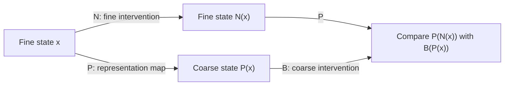
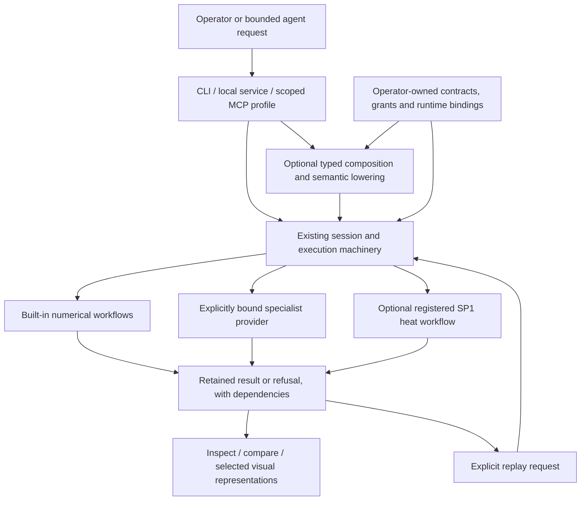

# Notations Engineering Terminal

**A compositional scientific and engineering instrumentation system: mathematical contracts, retained experiments, and scoped verification.**

Technical whitepaper and entry manual · Notation Systems Inc. · Documentation baseline: 2026-10-04

[Quickstart](#quickstart) · [Operator manual](docs/OPERATOR_MANUAL.md) · [Architecture diagrams](docs/SYSTEM_ARCHITECTURE.md) · [Instruments](docs/INSTRUMENTS.md) · [Model validity](docs/MODEL_VALIDITY_AND_EVIDENCE.md)

## Abstract

Industrial and scientific investigations connect observations, mathematical models, numerical programs and decisions. Those connections become difficult to review when units, coordinate systems, uncertainty, assumptions and software versions disappear between tools. **Notations Engineering Terminal (NET)** brings these elements into retained investigations with explicit interfaces and separate identities for evidence, operations, executions, results and verification.

NET combines typed workflow composition, state-space models, representation contracts, uncertainty propagation and bounded invariant checks. Its mathematical organizing principle is **state, permitted change, and preserved structure**. Category theory informs composition and representation relationships; finite measure-theoretic calculations make selected information-loss and preservation questions executable. Domain instruments supply particular numerical and physical models. **SP1 supplies an optional proof backend for selected registered programs**, followed by separate verification; it is one component of the system.

This paper describes that synthesis, its implementation boundaries and its use in measurement, estimation, process studies and simulation. It provides runnable examples and links to a complete operating manual. The contribution is an engineering architecture and its bounded implementations, rather than a new mathematical theory. Implemented software, recorded numerical evidence and qualification of an installed physical system are identified separately.

**Keywords:** computational instrumentation; applied mathematics; typed composition; invariants; representation preservation; metrology; scientific provenance; verifiable computation.

## Reading outline

1. [System category and industrial purpose](#1-system-category-and-industrial-purpose)
2. [Mathematical model and foundations](#2-mathematical-model-and-foundations)
3. [Architecture and functional responsibilities](#3-architecture-and-functional-responsibilities)
4. [SP1's role in the system](#4-sp1s-role-in-the-system)
5. [Applications and capability selection](#5-applications-and-capability-selection)
6. [Quickstart](#quickstart) and [worked preservation example](#6-worked-example-representation-and-intervention)
7. [Evidence, limitations and extension](#7-evidence-limitations-and-extension)
8. [References and further reading](#8-references-and-further-reading)

For step-by-step operation, use the [operator manual](docs/OPERATOR_MANUAL.md). For module-level flows and function names, use the [architecture companion](docs/SYSTEM_ARCHITECTURE.md).

## 1. System category and industrial purpose

NET's primary category is a **compositional computational instrumentation system**. It gives engineers a common way to declare a calculation, supply its inputs, execute a supported instrument, inspect its output, compare alternatives and retain the investigation. A metrology workflow is one application of this system; algebraic abstraction is part of its construction; a common notation and contract layer connects its instruments.

| Description | Meaning in this project | Present scope |
| --- | --- | --- |
| Computational instrumentation | Programs operated as instruments with explicit inputs, outputs, conditions and checks | Sessions, registries, providers, saved investigations and explicit replay |
| Algebraic composition layer | Compatible operations combine through declared interfaces and composition rules | Bounded dataflow algebra and a distinct production-stage ordering language |
| Metrology infrastructure | Measurement results retain calibration declarations, quantity meaning and uncertainty | Profile-specific processing and pilot preparation; installed-chain qualification needs experiments |
| Common scientific notation and contracts | State, representation, transformation, uncertainty and evidence can be described across tools | Versioned, extensible contracts; adapters declare and are checked against profile-specific semantics |
| Universal notation layer | Research ambition to express increasingly diverse instruments through a shared grammar | A research direction, with coverage established instrument by instrument |

The industrial purpose is to make a result usable beyond the program that first produced it: another person should be able to identify its source, reproduce the supported computation, inspect its assumptions and determine what further evidence is needed for a decision. Examples include comparing process cycles, evaluating a sensor configuration, transporting correlated uncertainty, checking a model reduction, and preparing a result for independent computation checking.

The operating loop is **author → run → observe → compare → modify → check**. Inputs, failed attempts and prior results remain inspectable. Reopening reads retained state; replay is an explicit new execution.

NET is the public engineering workbench within the broader Notation Systems stack. Acquisition, canonical evidence admission, deployment policy and equipment interfaces retain their declared responsibilities. The [stack map](docs/STACK.md) describes those relationships and integration status; a responsibility diagram does not imply an automatic end-to-end adapter.

## 2. Mathematical model and foundations

### 2.1 State, transformation and invariant

The research context summarizes an investigation as

$$
\mathcal{S} + \Delta\mathcal{S} + \mathcal{I},
$$

where $\mathcal{S}$ denotes an admissible state space, $\Delta\mathcal{S}$ a permitted variation, and $\mathcal{I}$ the structure to preserve. The plus signs express an organizing principle, not an arithmetic operation or a claim that every workload implements the same algebra.

Operationally, a transformation declares $f:X\rightarrow Y$, its parameters, constraints, representations, relevant invariants and evidence references. Coordinates carry names, units, frames and clock declarations. This separates the mathematical object from one matrix, graph, file or rendering used to represent it. The [state-transformation contract](docs/STATE_TRANSFORMATIONS.md) implements structural validation and content identity for those declarations. Execution and checking are separate actions.

An invariant must name a property and a checking procedure. Examples include matching quantity order in a covariance matrix, preserving a declared total heat capacity during a graph rewrite, or checking a model's mass balance against a stated tolerance. These are different obligations. A declaration that a quantity is conserved does not establish that a physical process follows the chosen model.

### 2.2 How the mathematical foundations contribute

| Foundation | Role in NET | Executable realization and boundary |
| --- | --- | --- |
| Category theory and compositional algebra | Describe typed operations, compatible composition and representation relationships | [Workflow algebra](docs/WORKFLOW_ALGEBRA.md) implements `call`, `sequence`, `parallel`, `identity` and `permute`. [Semantic capabilities](docs/SEMANTIC_CAPABILITIES.md) bind meanings to engines. This is a bounded adaptation, without a project-wide categorical proof. |
| Invariants and constraints | Make preservation and admissibility explicit | [Hypergraph rewriting](docs/HYPERGRAPH_REWRITE.md) checks typed rules and declared sums; scientific models provide their own conservation and numerical checks. Each checker has a stated domain. |
| Measure theory and probability | Describe probability transported through a representation and distinctions lost under reduction | [Finite preservation](docs/FINITE_REPRESENTATION_PRESERVATION.md) computes exact rational pushforwards, conditional moments and finite intervention checks. It uses declared finite tables, not a general continuous-measure engine. |
| Linear algebra and differential sensitivity | Represent state maps, observability and uncertainty transport | [Covariance propagation](docs/COVARIANCE.md) retains ordered quantities and full matrices; local Jacobian propagation depends on its supplied model and assumptions. |
| Dynamical systems and numerical analysis | Calculate trajectories and compare predicted behavior | [Thermal/system models](docs/SYSTEM_COMPOSITION.md), [fluid models](docs/FLUID_DYNAMICS.md) and specialist instruments retain model-specific references, residuals and refinement checks. |
| Algebraic topology | State a finite exact checker predicate | [F2 checker preparation](docs/PROOF_WORKLOADS.md) computes ordinary simplicial Betti numbers; its candidate SP1 guest is unregistered and preparation is not a proof. |
| Graph, matroid and representation theory | Motivate separating structure from a chosen representation | The [research lineage](docs/RESEARCH_FOUNDATIONS.md) explains the adaptation. Graph-theoretic results do not automatically establish cross-domain equivalence. |
| Information theory and model comparison | Require an explicit comparator, loss and account of discarded information | Research guidance for reductions and model choices; no universal engineering loss or automatic optimal representation is claimed. |
| Cryptographic verifiable computation | Check a bound program execution independently of a retained host report | The [registered SP1 heat profile](docs/PROVED_HEAT.md) binds guest and input/output commitments. Its proof concerns that computation. |

These foundations have different roles: some supply numerical algorithms, some define interface laws, and some guide research. The [foundations and attribution guide](docs/RESEARCH_FOUNDATIONS.md) distinguishes established mathematics, architectural adaptation, project hypotheses and implemented evidence.

### 2.3 Composition and preserved meaning

For compatible operations $f:X\rightarrow Y$ and $g:Y\rightarrow Z$, serial composition expresses $g\circ f$. Parallel composition places independent typed interfaces side by side. NET checks schema, unit, frame, clock and meaning declarations, plus operator-declared effects and permissions. It does not infer unit conversions or copy a state handle implicitly.

The bounded algebra tests identity, associativity, permutation inversion and dataflow interchange. Its normal form preserves call labels and output selectors; it does not decide arbitrary scientific equivalence. Production-stage barriers have different semantics from dataflow wires. The mathematical background is described by [Patterson, Spivak and Vagner](https://arxiv.org/abs/2101.12046); NET's actual laws, bounds and execution semantics are specified in [WORKFLOW_ALGEBRA.md](docs/WORKFLOW_ALGEBRA.md).

For a representation map $P:X\rightarrow Y$, a fine-state intervention $N:X\rightarrow X$ and a proposed coarse intervention $B:Y\rightarrow Y$, the preservation question is

$$
P\circ N = B\circ P.
$$



*Figure 1. The finite preservation checker compares both paths at every declared state, including states assigned zero probability. It retains counterexamples. This is a finite check, not a universal commutativity theorem.*

### 2.4 Probability and uncertainty are explicit mathematical objects

For a finite probability table $p(x)$, projection through $P$ gives

$$
p_Y(y)=\sum_{P(x)=y}p(x),\qquad
\mathbb{E}[f\mid P=y]
=\frac{\sum_{P(x)=y}p(x)f(x)}{p_Y(y)}
\quad\text{when }p_Y(y)>0.
$$

NET's finite checker uses exact rational arithmetic on 1–64 labels per space. Zero-mass fibres retain their labels and an undefined conditional result. The pushforward construction is established mathematics; see the [Mathlib formal reference](https://leanprover-community.github.io/mathlib4_docs/Mathlib/MeasureTheory/Measure/Map.html). Mathlib is a reference, not a proof certificate for NET's Python code.

For affine uncertainty transport $y=Ax+b$ with fixed $A,b$ and finite second moments, $C_y=A C_x A^{\mathsf T}$. A differentiable nonlinear measurement model may instead use the local approximation $C_y\approx J C_x J^{\mathsf T}$. NET retains quantity order, correlation, units and covariance sources; it does not supply missing physical assumptions. Finite probability preservation, measurement uncertainty and metrological traceability are distinct concepts. The [JCGM publications](https://www.bipm.org/en/committees/jc/jcgm/publications) provide measurement-model and uncertainty background; each NET profile states which treatment it implements.

## 3. Architecture and functional responsibilities



*Figure 2. Implemented responsibility paths, selected per workflow. Optional composition lowers into existing execution machinery. The heat branch requires its provisioned backend and proof gate. Retention and inspection do not imply canonical evidence admission or physical control.*

| Layer | Responsibility | Source and operating contract |
| --- | --- | --- |
| Representation and composition | Declare state spaces, semantic capabilities, Board connections and workflow structure | [State transformations](src/ciw/state_transformation.py), [semantic registry](src/ciw/semantic_capabilities.py), [workflow algebra](src/ciw/workflow_algebra.py) |
| Session and operations | Capture inputs and selection; dispatch registered operations; retain successful results and accepted execution refusals | [Session](src/ciw/session.py), [operations](src/ciw/operations), [protocol](docs/PROTOCOL.md) |
| Scientific instruments | Own numerical algorithms, physical assumptions, applicability and supported checks | [Instrument catalogue](docs/INSTRUMENTS.md), [runtime responsibility map](docs/EXECUTION_RESPONSIBILITIES.md) |
| Evidence and checking | Retain provenance, dependencies, comparisons and separately scoped verification | [Correction loop](docs/CORRECTION_LOOP.md), [model validity](docs/MODEL_VALIDITY_AND_EVIDENCE.md), [proof profile](docs/PROVED_HEAT.md) |
| Clients and representations | Inspect retained state through terminal, browser, agent and selected engine interfaces | [Local quickstart](docs/quickstart.md), [agent protocol](docs/NET_AGENT_PROTOCOL.md), [interactive simulation](docs/INTERACTIVE_SIMULATION.md) |

The monorepo co-locates 21 imported public modules under [instruments/](instruments), preserving package identities, source history and licences. Some bindings still need separately provisioned checkouts, interpreters, executables or credentials at explicit pins. Source consolidation does not establish runtime availability. The root distribution is `computational-instrumentation-workbench`, the Python package is `ciw`, and the composition/control CLI is `net`; the existing `ciw` CLI remains available.

The implementation protects the distinction

$$
\text{evidence identity}\ne\text{operation identity}\ne
\text{execution identity}\ne\text{result identity}\ne
\text{verification identity}.
$$

A numerical result can be identical across two runs while execution identities differ. A saved report records a past check; it does not perform a new check when opened. Graphical representations interact through their specified contracts. Blender retains its authoring role; Godot and Bevy retain their own live worlds and clocks.

The [architecture companion](docs/SYSTEM_ARCHITECTURE.md) expands this overview into request, compilation, representation and proof diagrams with source-level function mappings. [ARCHITECTURE.md](docs/ARCHITECTURE.md) and [PROTOCOL.md](docs/PROTOCOL.md) own detailed runtime behavior.

## 4. SP1's role in the system

**SP1 is the optional verifiable-computation backend for an explicitly selected program or checker. NET defines the engineering investigation and its contracts; the Scientific Computation Runtime (SCR) supplies the registered execution/proof integration; SP1 supplies the proof machinery.**

The useful question is: *does this proof verify for the intended compiled program and the required public input/output commitments?* It differs from asking whether a sensor was calibrated, whether a model represents a machine, or whether an operator may act on a result. The upstream [SP1 documentation](https://docs.succinct.xyz/docs/sp1/getting-started/quickstart) describes its workflow; NET's [registered heat guide](docs/PROVED_HEAT.md) fixes the integration contract and source, compiler, backend and guest identities.

### Registered heat computation

The shared operation `ciw.proved-heat.v1` runs SCR's native integer Jacobi calculation, produces an SP1 proof, checks native/guest input and output commitments, and invokes a separate verifier bound to the registered full ELF. A successful result requires those checks; a failed proof cannot silently become an unproved success.

This profile accepts 3–32 cells, 0–64 steps, and integer magnitudes at most `2^40`, with fixed endpoints, dimensionless values and mandatory empty native configuration. Mathematical settings belong to the fixed guest or its consumed input. Interior updates use

```text
next[i] = current[i] + trunc_toward_zero(
    (current[i-1] - 2*current[i] + current[i+1]) / 4
)
```

For `[0,100,200,100,0]` and four steps, the final field is `[0,65,92,65,0]`. The proof concerns that bounded integer computation. It does not turn values into calibrated temperatures or establish a continuous heat-equation solution. Program semantics, guest/build binding and proof-system assumptions remain part of the claim.

### Three different operator actions

| Action | What happens | Required environment |
| --- | --- | --- |
| Inspect a retained heat bundle | Check stored content/linkage and read the historical report | Saved artifacts; no fresh proof verification occurs |
| Replay the heat workflow | Execute again, produce another proof and retain new occurrence identities | Original supported runtime identities and provisioned proving backend |
| Freshly verify a retained proof | Invoke the verifier and produce a new verification report linked to the original bundle | Trusted compatible verifier host, expected registered guest and required commitments |

The pinned guest build recipe requires Linux. Native Windows can inspect saved records; local proving needs a suitable Linux environment or separately provisioned compatible backend. Follow [PROVED_HEAT.md](docs/PROVED_HEAT.md) for exact setup, commands and the genuine proof gate. Structural tests with synthetic proof bytes are not evidence that this gate passed. Implemented source alone does not qualify a deployment.

### Scope of additional proof work

The [F2 checker](docs/PROOF_WORKLOADS.md) prepares exact finite-homology calculations and proof obligations; its candidate guest remains unregistered and preparation is explicitly `prepared_not_proved`. Composition of obligations does not authenticate or recursively aggregate child proofs. Julia execution is separately bound, and arbitrary Julia/Rust programs do not acquire SP1 coverage through their language choice. A temperature-specific guest and PINN/gPINN comparisons remain programme work. NET's retained heat profile exposes its input/output; it makes no privacy claim. Upstream [SP1 security modes](https://docs.succinct.xyz/docs/sp1/security/security-model) have distinct privacy properties.

## 5. Applications and capability selection

| What you want to do | What NET can provide | What must be supplied or established |
| --- | --- | --- |
| Inspect a recording or compare analyses | Statistics, spectra, selected observations, retained results and replay | Supported recording contract, meaningful units/time and a stated comparison |
| Study industrial measurement uncertainty | Affine calibration and full joint covariance in supported profiles | Calibration evidence, applicability and a defensible uncertainty budget |
| Evaluate a polymer process cycle | Cycle reports, bounded cooling/pressure-arrival estimates and comparison context | Applicable geometry/material/process assumptions; experimental process validation |
| Estimate an unobserved thermal state | A bounded estimator driven by calibrated recordings and comparison to a held-out reference | Compatible streams, model parameters and separate model/measurement validation |
| Study fluid exchange or coupling | Bounded reservoir/compliant-boundary and periodic surface-wave models | The declared domain; extensions need new models and checks |
| Compose experiments or change their structure | Typed workflows, parameterized Boards and bounded graph rewriting | Bound operations, effects, dependencies and invariant checks |
| Test a reduced representation | Exact finite probability and intervention-preservation witnesses | Complete finite tables and a justified relationship to the intended problem |
| Produce a checkable computation artifact | Registered heat proof bundles and fresh verification | Exact backend and guest; genuine proof qualification for the selected case |
| Build simulations and interactive environments | Selected BIM, spatial, geometry and engine workflows | Supported adapters and native tools; views retain their declared authority |

### Polymer workflows

`net polymer demo --output-dir results/polymer-demo` retains a synthetic cycle report and audit. `net polymer qualify --output-dir results/polymer-qualification` exercises the documented bounded workflow. The [polymer guide](docs/POLYMER_PROCESSING.md) covers process profiles and native calibration import. [Leakage accounting](docs/leakage.md) adds retained coolant-volume/material-mass calculations through pinned FlowState providers; an unaccounted deficit does not establish its cause.

### Temperature measurement and qualification

A retained [public TCLab temperature experiment](docs/TEMPERATURE_RECORDINGS.md) exercises offline acquisition-file import, observation export and Session save/reopen. The importer binds the original 201-row CSV to a reviewed source manifest, preserves irregular elapsed host times, and keeps T1/T2 sensor temperatures separate from Q1/Q2 heater-command percentages. This archived experiment does not establish a calibrated polymer measurement or supply shell/core, measured heat-power or independent-reference inputs to the thermal estimator.

There are two separate computational paths: affine conversion of 1–64 sensor observations with joint raw/calibration covariance, and [thermal estimation from recordings](docs/MEASURED_THERMAL.md). The latter takes already-calibrated shell, power and ambient streams, retains a held-out core reference, and does not propagate its retained input uncertainty. These paths have separate contracts and no automatic handoff. The temperature processing profile also supplies a separate numerical checker against an exact rational first-order reference. Its PASS/FAIL and verification occurrence remain distinct from processing acceptance and physical qualification; inspect the audit even when the graph completes.

Prepare the synthetic processing profile with `python -m ciw.agent_mcp temperature-config --output-dir results/temperature-agent`. It intentionally has an incomplete uncertainty budget, so acceptance remains indeterminate. The [agent protocol](docs/NET_AGENT_PROTOCOL.md#temperature-measurement-processing-profile) explains serving it and supplying an operator-prepared request.

The [pilot protocol](docs/TEMPERATURE_QUALIFICATION.md), [setup record](examples/temperature/pilot-setup.json), [product-conformity guide](docs/TEMPERATURE_PRODUCT_CONFORMITY.md) and [assessment record](examples/temperature/conformity-assessment.json) support planning for an installed chain. The setup now cites a published polymer heating experiment and a NIST reference method, with proposed targets distinguished from published facts and missing calibration evidence. A [pilot-readiness inventory](docs/TEMPERATURE_PILOT_READINESS.md) checks declarations and records unresolved evidence; it does not establish physical qualification. These records are not executable processing requests. Raw observations, sensing-element temperatures and polymer estimates keep distinct labels.

### Bounded dynamic fluid models

`net fluid` exposes a time-dependent two-reservoir model with a bidirectionally coupled compliant boundary, and a separate periodic linear surface-wave profile. The [fluid guide](docs/FLUID_DYNAMICS.md) supplies equations, commands, reference comparisons and the supported scalar-state handoff. General CFD/molecular coupling and experimental fluid validation remain separate development work.

### Evolving workflow structures

`net rewrite` applies fixed typed rules for replication, declared parameter variation, coupling and thermal-zone splitting with preserved declared heat capacity. [Retained histories and schedule checks](docs/HYPERGRAPH_REWRITE.md) make structural changes reviewable. Model execution still calculates behavior; structural preservation alone does not establish predictive accuracy.

## Quickstart

Use Python 3.11 or newer from the repository root, preferably inside a virtual environment. The [operator manual](docs/OPERATOR_MANUAL.md) and [platform-specific quickstart](docs/quickstart.md) include Windows and POSIX setup.

```sh
python -m pip install .
net doctor --profile core
net catalog
net start --output-dir results/first-use-001
```

`doctor` checks local package/dependency metadata. `catalog` reports supported surfaces and provider requirements. `start` runs bounded synthetic oscillator, thermal-observer and atmospheric checks and retains `results/first-use-001/readiness.json`, including named checks and artifact paths. Use a fresh output directory. This receipt describes the checks actually run for that installation.

For a persistent local investigation:

```sh
net workbench --output-dir results/workbench
```

Leave the process running and use a second activated terminal:

```sh
ciw health
ciw send session.get
ciw send analysis.stats
ciw send result.list
ciw send workspace.save
```

`analysis.stats` creates a new result; the other commands inspect or save the session. Save before stopping the server. Restarting reopens retained state without rerunning numerical operations. The service defaults to loopback. The [installed-tool guide](docs/RUN_NET.md) and [operator readiness guide](docs/OPERATOR_READINESS.md) cover further profiles.

The canonical repository is [atomtrapping/Notations-Engineering-Terminal](https://github.com/atomtrapping/Notations-Engineering-Terminal).
The distribution name is `computational-instrumentation-workbench`, its Python
import is `ciw`, and its commands are `net` and `ciw`. Imported packages retain
their own identities and licences in the [module manifest](instruments/manifest.json).

## 6. Worked example: representation and intervention

This provider-free example connects the mathematical framework to an actual command. It supplies four equally weighted labels with observable values 270, 274, 290 and 294 K, grouped into two coarse labels. The temperatures are synthetic arithmetic values, not physical measurements.

```sh
net morphism finite-demo --output-dir results/finite-demo
net morphism finite-check results/finite-demo/registry.json results/finite-demo/compatible-spec.json --output results/finite-checked.json
net morphism finite-verify results/finite-demo/registry.json results/finite-demo/compatible-witness.json
net morphism finite-verify results/finite-demo/registry.json results/finite-demo/incompatible-witness.json
```

| Retained quantity/check | Compatible intervention | Incompatible intervention |
| --- | --- | --- |
| Coarse probabilities | 1/2, 1/2 | 1/2, 1/2 |
| Conditional means | 272 K, 292 K | 272 K, 292 K |
| Original/integrated conditional mean | 282 K / 282 K | 282 K / 282 K |
| Expected within-group variance | 4 K² | 4 K² |
| Resulting distributions match | Yes | Yes |
| State-level intervention square | PASS | FAIL; two counterexamples |

The last command intentionally returns exit code **2** for a valid retained negative result; the compatible case returns **0**. Refused/malformed input returns **1**. A successful demonstration retains both cases.

Preserving average behavior or even the resulting distribution does not establish that a simplified representation can support every proposed intervention. This checker makes that distinction executable for its supplied finite model. It does not automatically approve a live control action. See [finite preservation](docs/FINITE_REPRESENTATION_PRESERVATION.md) for the complete contract and extension boundary.

## 7. Evidence, limitations and extension

### Read a result according to the check that produced it

| Evidence | Supports | Requires separate evidence |
| --- | --- | --- |
| Hashes and retained source bytes | Content identity and inspectable lineage | Authentic acquisition and physical representativeness |
| Numerical comparison or invariant check | The stated property on exercised inputs under its tolerance/policy | General validity outside that scope |
| Reproducible replay | A new execution under recorded bindings, with the reported comparison | Adequacy of underlying scientific assumptions |
| Fresh SP1 verification | The registered computation bound to the required public statement, under its assumptions | Calibration, model validity, training correctness or equipment permission |
| Calibration and independent physical experiments | Performance for the reviewed measurement chain and conditions | Transfer to new installations, conditions and continued stability |

The [model-validity guide](docs/MODEL_VALIDITY_AND_EVIDENCE.md) separates computational domain, physical applicability and validation coverage. The [integration matrix](docs/INTEGRATION_COVERAGE.md), [capability ledger](release/capability-ledger.json) and [research-release plan](docs/QUALIFIED_RELEASE.md) record detailed status. This documentation update reports no new physical experiments, full-release qualification or genuine SP1 proof campaign.

Current software supports bounded research workflows. Missing providers refuse; unknown uncertainty remains unknown; unqualified configurations retain their status. Equipment control, remote multi-user deployment and hard real-time operation need their own implemented and qualified interfaces. Source correction can change dependency status without erasing historical results.

### Reproducible numerical examples

The [nine installed-package examples](docs/DOMAIN_EXAMPLES.md) exercise bounded
oscillator, impact, fluid, thermal, polymer, temperature and structural-rewrite
paths. Their retained reports identify the wheel, input artifacts and outcomes.
The separate [independent numerical comparisons](docs/EXTERNAL_NUMERICAL_COMPARISONS.md)
compare reservoir trajectories with SciPy integration and polymer cooling with
homogeneous and convective-slab references. These checks separate arithmetic
agreement from spatial-model discrepancy; they do not establish installed-chain
physical performance. Their [Linux/Windows workflow](.github/workflows/review-examples.yml)
retains success and failure evidence.

### Extend an instrument through a reviewable contract

1. Define the task, state variables, representations, units, clocks and validity domain; state the decision or query the instrument must support.
2. Declare the transformation, parameters, constraints, uncertainty treatment and required invariants. Record information discarded by any reduction.
3. Bind the versioned operation to an explicitly provisioned provider, including numerical settings, source/runtime identities and resource limits.
4. Retain outputs and refusals. Test analytical or independent references, boundaries, missing data, refinement and failed invariants as appropriate to the model.
5. Establish physical evidence for the intended use. Add a proof profile only with an explicit guest, arithmetic contract and genuine positive/negative verification campaign.

For development commands, use [DEVELOPMENT.md](docs/DEVELOPMENT.md). Inspect the import registry with `python scripts/superrepo.py list`; the source-history audit `python scripts/superrepo.py audit` needs a full-history checkout. The [monorepo guide](docs/MONOREPO.md) describes preservation of module history and licences. The [technical reference](TECHNICAL_REFERENCE.md) retains earlier reference material; newer operation-specific guides own later additions.

## 8. References and further reading

The sources support their stated mathematical or technical subjects. NET's adaptations and implementation evidence are documented separately.

1. Patterson, E., Spivak, D. I., and Vagner, D. (2021). [Wiring diagrams as normal forms for computing in symmetric monoidal categories](https://arxiv.org/abs/2101.12046). Background for typed serial/parallel composition; see NET's [bounded algebra contract](docs/WORKFLOW_ALGEBRA.md).
2. Mathlib contributors. [Measure pushforward and map composition](https://leanprover-community.github.io/mathlib4_docs/Mathlib/MeasureTheory/Measure/Map.html). Formal mathematical reference; NET's [finite witness implementation](src/ciw/finite_preservation.py) has its own checks.
3. Joint Committee for Guides in Metrology. [Measurement and uncertainty publications](https://www.bipm.org/en/committees/jc/jcgm/publications). Context for measurement models and uncertainty; see NET's [covariance contract](docs/COVARIANCE.md) and [pilot protocol](docs/TEMPERATURE_QUALIFICATION.md).
4. Succinct. [SP1 development documentation](https://docs.succinct.xyz/docs/sp1/getting-started/quickstart). NET uses the fixed identities in its [registered heat profile](docs/PROVED_HEAT.md), rather than an implicit latest backend.
5. Notation Systems. [Research context](docs/RESEARCH_CONTEXT.md) and [research foundations and attribution](docs/RESEARCH_FOUNDATIONS.md). Further lineage in graph/matroid theory, information theory, ontology patterns, model families, state-space methods and numerical analysis.

## Organization and licence

NET is shared infrastructure developed by **Notation Systems Inc.** across **Notations Gaming**, **Notation Manufacturing** and **Notations Laboratories**: interactive worlds, design and manufacturing systems, and scientific research and validation. [Notation Systems](https://notation.systems).

**© 2026 Giason Pooni, for original contributions.** The root code is governed by the existing [LICENSE](LICENSE). Imported modules retain their own licences and upstream notices. Project-owned original assets use the [asset permission policy](docs/licensing/ORIGINAL_ASSETS.md). Repository publication does not change those terms or confer evidence, signing or execution authority.

Imported-component inventory does not establish clearance for a combined distribution; see the [distribution and network-source policy](docs/LICENSING.md#distribution-and-network-source).
