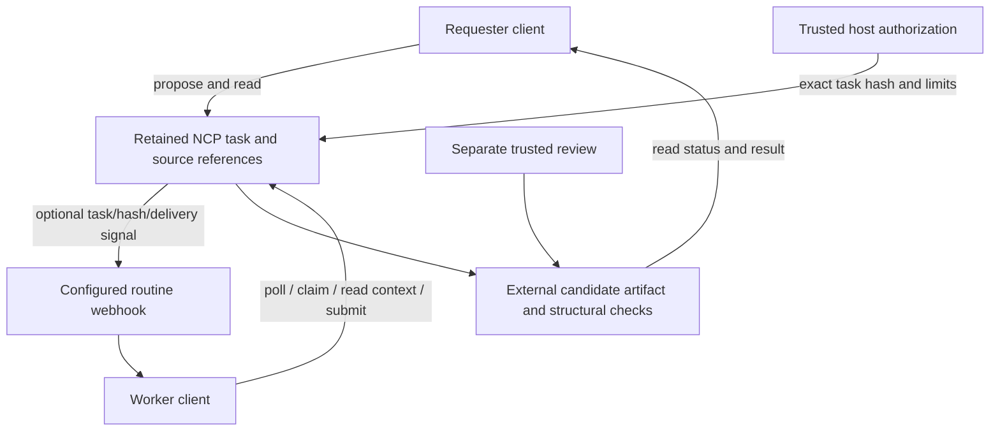

# Shared external task and evidence adapter

The bounded `ciw.external-work-task.v1` adapter lets a requester and an external
worker use the same retained task, approved source excerpts, attempts and candidate
submission. It addresses the missing exchange for a **corpus candidate-extraction
investigation**, with the parent investigation/intent reference supplied by the
host. Native references remain references; this adapter does not create another
Session, provider registry, scientific evidence adjudicator or execution engine.

Implemented: persistent SQLite coordination, a separate stdio MCP profile using
`ciw.agent_mcp.Server`/`serve`, authenticated Streamable HTTP, and optional
bearer-authenticated routine notification. The retained corpus reader accepts an
operator-provided hash-pinned bundle; no real corpus bundle or task database is
included in this repository.
`ciw.external_work_corpus.bind_span` binds selected exact source windows and their
unresolved findings to task context. It grants no source disclosure or scientific
acceptance. See [Cloudflare connector setup](EXTERNAL_WORK_CLOUDFLARE.md) for the
separate requester/worker custom connectors and their activation requirements.

## Authority and data flow



Both model clients have narrow data-plane operations. The host provisions client
identities and investigation scope, approves source disclosure, authorizes an exact
task hash, and records a separate review. There is no model-facing authorization,
review, credential, webhook, provider execution, shell, arbitrary URL, file-path,
email, billing, deployment, merge or physical-actuation tool.

The Python store's administration methods are **trusted host APIs**, not an
authentication service. An `approval_ref` is an operator-attested reference supplied
after the host verifies approval; the string alone is not a signed credential and
cannot be submitted through MCP. Any human or policy authentication for approval
and review must be established by the integrating host. Native parent, snapshot and
version references are retained, not resolved against an absent central registry.

## Retained contracts

| Record | Retained meaning |
| --- | --- |
| Context | Parent and approved snapshot references, source ID/version, verified full-source SHA256, exact UTF-8 byte window, excerpt text and excerpt SHA256. Optional provenance retains corpus span, source URL, disclosure reference, unresolved findings and limitations. Context ID hashes the whole record. |
| Task | Server-assigned task ID, requester, revision 1, parent reference, instruction, expected output and 1–4 context IDs. Existing CIW canonical JSON/content identity binds the complete task body. |
| Authorization | Host-verified approval reference, exact task hash, one authenticated worker account/client, expiry, lease duration, maximum attempts and result bytes. Allowed operations and result destination are fixed by this profile. |
| Attempt | Caller-stable attempt ID, authenticated client ID, unverified Bot label, claim time and expiry. A label never grants authority or establishes an isolated machine identity. |
| Submission | Native `result-` occurrence identity, exact canonical artifact hash, candidate, outcome, exact quoted citations, limitations, worker/attempt identity and timestamp. Structural checks are separate from semantic assessment. |
| Review | Native `decision-` occurrence identity, result identity, reviewer reference, acceptance scope, findings and decision. It creates no verification occurrence or physical qualification. |
| Delivery | Caller-stable delivery ID, preparation/receipt times and `unknown`, `acknowledged` or `failed` status. Credentials, endpoint URL, HTTP response text and task instructions are excluded. |

Tasks and source contexts are immutable. Changed work uses a new request key and
task, linked through its existing native parent reference; revision is fixed at 1
in this initial profile. A proposal key is unique per requester: same key and body
returns the retained task; changed body is refused. Records are retained without
automatic pruning. The operator is responsible for retaining the original full
source artifact; the database retains its approved excerpt and full-source digest.

The authorization and review are each immutable once recorded. `needs_review`
records unresolved review rather than pretending acceptance. This pilot has no
review amendment or revision API; follow-up work is a new linked assignment.
Cancellation, client revocation, source revocation and expiry can stop further
access without rewriting the original task or submission.

Task execution states are `proposed`, `authorized`, `claimed`, `submitted` and
`cancelled`. A submitted artifact may report `completed` or `blocked`; either still
requires review. Review decisions are `accepted`, `rejected`, or `needs_review`.
Delivery status is independent of all of these.

## MCP profile

| Tool | Allowed client | Behavior |
| --- | --- | --- |
| `ncp_work_propose` | Requester | Retain a proposal with a stable `request_key`; cannot authorize it. |
| `ncp_work_discover` | Either | Bounded polling. Workers see eligible authorized tasks only; requesters see their own tasks. |
| `ncp_work_read` | Either, scoped | Read retained task, attempts, delivery, submission and review. |
| `ncp_work_context` | Either, scoped | Read only one of this task's approved context IDs. |
| `ncp_work_claim` | Assigned worker | Atomically acquire a lease at `expected_hash`; same attempt retries do not renew it. |
| `ncp_work_submit` | Assigned worker | Retain one candidate per active attempt; reject stale or conflicting writes. |
| `ncp_work_cancel` | Owning requester | Cancel unsubmitted work and deny further worker access. |

The input schemas are advertised through the existing MCP transport. Tool results
are `{status: "ok", data: ...}` or `{status: "refused", reason: <stable code>}`;
refusals set `isError: true`. Unknown fields are rejected. Common refusal codes
include `role_refused`, `scope_refused`, `idempotency_conflict`,
`task_hash_mismatch`, `task_already_claimed`, `stale_attempt`, `client_refused`,
`authorization_expired`, `context_unavailable` and `citation_mismatch`.

`discover` returns `items`, `next_after` and `poll_again_from: 0`. Follow
`next_after` until null for one bounded scan. **Start each new poll at zero**:
an older task may have become authorized or its claim may have expired since the
previous scan. Polling cadence belongs to the existing worker routine/host; this
adapter creates no scheduler. List responses omit task/source text.

All calls recheck the client's retained enabled flag and scope. Worker access also
checks assignment, authorization expiry and cancellation. Source integrity and
revocation are checked on read, discovery, claim and submission. SQLite
`BEGIN IMMEDIATE` serializes claims and idempotent writes across local processes.
One accepted submission is retained per task; expired attempts can be reclaimed
within the host's attempt budget. An old worker cannot submit under a new lease.
Already-retained, identical submissions can be reread after lease expiry while
the overall authorization is still valid. A successful submit is not scientific
acceptance; exact quote matching does not validate the candidate's interpretation.

Default limits are a 300-second lease, 3 attempts and 16 KiB result. Host maximums
are a 3600-second lease, 8 attempts and 32 KiB result. There are at most 4 excerpts
of 8 KiB each, 4 wake-up deliveries per task and 1024 retained tasks per requester.
The latter is a lifetime pilot storage bound, not a rate limiter. No cost, CPU,
browser or unrelated connector capabilities outside NCP are controlled here.

## Optional routine wake-up

The [official routine documentation](https://prod.cursor.com/help/grok-bot/routines)
describes an HTTPS POST with `Authorization: Bearer <key>` and an optional JSON
body. HTTP 200 acknowledges a started routine; it does not mean that the work
finished. Documentation was checked on 2026-10-07. Account availability and an
actual configured routine have not been verified.

`RoutineWakeup` takes an **operator-supplied** endpoint, explicit allowed-host tuple
and environment-variable name for the secret. The key is read at send time so
rotation does not require persisting it in task records. HTTPS/TLS verification,
port 443, no URL credentials/query/fragment, no redirects and no ambient proxies
constrain delivery. Host egress/DNS restrictions remain a deployment responsibility.

`store.wake(..., adapter=None)` is disabled by default and leaves polling available.
With a configured adapter it sends only `{task_id, task_hash, delivery_id}`. It
commits an `unknown` delivery before network I/O. Same delivery-ID retries return
the stored outcome and never send again, including after a timeout or crash. A
deliberate host retry needs a new delivery ID and consumes another delivery slot.
There is no exactly-once execution claim for the external routine. Duplicate or
late routine runs must still claim the authoritative task at its expected hash.

Cancellation may race with network I/O and a routine can wake after cancellation.
Its subsequent claim/context/submission is refused. Delivery cannot change the
task instruction, source context, authorization or review. No routine is created
and no external notification is sent merely by installing or launching the profile.

## Run the synthetic local pilot

Install the project with its pinned development dependencies, then from the
repository root use a fresh output directory:

```powershell
python examples/external-work/pilot.py --output-dir results/external-work-pilot-001
python -m pytest tests/test_external_work.py -q
```

The pilot provisions synthetic requester/worker identities, retains a synthetic
source excerpt, proposes and locally authorizes an extraction, discovers it by
polling, claims it and submits a candidate. It records `needs_review`, then saves
`report.json`, `external-work.sqlite3` and the original synthetic source. The two
client hosts read exactly the same context. No Bot, model or remote endpoint is
called; fixture grants and reviews are not representations of human approval or
installed-chain evidence.

Separate trusted local launchers can connect to the **same** database:

```powershell
python -m ciw.external_work_mcp --database results/external-work-pilot-001/external-work.sqlite3 --principal fixture-requester
python -m ciw.external_work_mcp --database results/external-work-pilot-001/external-work.sqlite3 --principal fixture-worker
```

These commands are stdio servers, not network listeners. The launcher chooses the
principal after authenticating its client; model arguments cannot choose it. Do
not expose the database, Python administration object or launch flags to an
untrusted worker. Filesystem access to them is trusted host authority. Place the
database on service-owned local storage, not Drive, OneDrive or a network share;
backups must use SQLite's backup facility or be taken with all writers stopped.

## Deployment and evidence gaps

The authenticated HTTP gateway is implemented and tested. The repository includes
only a placeholder deployment configuration, not provisioned Cloudflare resources
or a connected ChatGPT/Bot bridge. Activation requires the approved login,
exact OAuth callback registration, signed-subject bindings and a running tunnel.
Host approval/review policy and operator-approved source disclosure remain
separate. Routine wake-up also needs a verified endpoint and secret if wanted.
A model-supplied client ID or Bot label is never proof of identity. Restricting
access through NCP does not sandbox the worker's other connectors or computer.

The tests exercise real local transactions, concurrency, restart recovery and
MCP subprocess transport, actual SDK Streamable HTTP, loopback TCP and RSA-signed
Access-token fixtures. Routine delivery tests use explicit HTTP test doubles;
they establish request construction and refusal behavior, not live service
availability. The example establishes software exchange only. Scientific corpus
extraction/adjudication, archive rights review, provider qualification and physical
instrument validation remain outside this increment.
