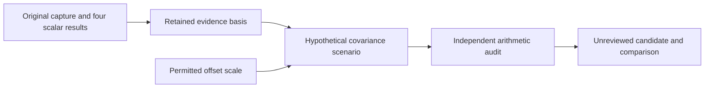

# GaugeLink uncertainty scenarios through MCP

The GaugeLink profile joins retained scalar measurements to the existing Board refit journey. The operator binds a measurement bundle, its original model and arithmetic audit, a fixed uncertainty objective, and an existing local execution grant. MCP and CLI call the same seven Board domain operations.

## Qualified scope

This first profile varies only `hypothesis.offset_scale` in `[0, 0.99]`. The baseline assumption is 0.5; the demonstration candidate is 0.25. These are hypothetical amplitudes of the shared offset error, not new calibration coefficients or measured improvements. The native improvement provider evaluates the complete `D Sigma D` covariance, including signed cross terms, at fixed input means and correlation structure. Its independent rational auditor checks the calculation.

The original covariance, raw capture bytes, source request, calibration declaration, four scalar-study occurrences, and objective remain unchanged. Missing covariance is refused. Uncertainty reduction may increase total variance where correlations cancel; a smaller scale is not automatically an improvement. The objective is operator-selected context and cannot be edited through MCP or used as acceptance authority.

## Retained execution



Baseline execution adds three occurrences: a basis projection, the hypothesis and its audit. A candidate restores the baseline Session and uses Needle to reuse the basis occurrence and rerun only `hypothesis` and `audit`. It adds two occurrences. Original measurement operations are never invoked as providers; restoring a Session does run their existing deterministic payload validators. No acquisition occurs.

Three small adapter operations (`link.refit-basis.v1`, `link.refit-scenario.v1`, `link.refit-audit.v1`) have explicit semantic mappings and retained input dependencies. They delegate the scientific arithmetic to `link_improvement.review` and the existing rational audit. No occurrence is relabeled as a different provider. The rational audit accepts explicit calculation inputs so its returned reference names the real scenario result.

The trusted `execution_profile` seam supplies registry/semantic bindings, preflight, Session restoration and retained-workspace checks to BoardRefitHost and BoardWorkbench. Omitting it retains the original oscillator-only path. No tool accepts a profile class, module, provider selector or filesystem path.

## Local use

Install the package with the existing `board-mcp` extra. A synthetic demonstration is explicit:

```sh
ncp gaugelink-refit demo --output-dir results/gaugelink-demo
ncp gaugelink-refit status --profile results/gaugelink-demo/profile/profile.json
ncp gaugelink-refit serve --profile results/gaugelink-demo/profile/profile.json
```

The demonstration creates a synthetic Station scalar study and its bounded example grant. It does not claim installed hardware or a calibration certificate. The returned `mcp-config.json` selects the Python environment and profile for a stdio-capable client; configuration is not automatically activated.

To use a retained measurement bundle without generating a grant:

```sh
ncp gaugelink-refit prepare --bundle measurement.json --output-dir results/selected \
  --instance-id station.local --max-standard-uncertainty 0.03
ncp gaugelink-refit configure --prepared results/selected --grant operator-grant.json \
  --investigation-ref investigation:station-scenario
```

The `0.03` example is in the original corrected-mean unit; select an appropriate objective for the actual investigation. `prepare` returns the exact Board/source references needed by the existing `ciw.board-refit-grant.v1` contract and writes the source and Board for inspection. It creates no authority. The grant must name only `hypothesis.offset_scale`, with explicit baseline permission and bounded preview/candidate budgets. A grant for another Board or source is refused.

## One journey

1. `ncp_board_status`: obtain the bound Board, permitted parameter and source/basis/provider identities.
2. `ncp_board_preview`: use the Board reference, node `hypothesis`, parameter `offset_scale`, replacement `0.25`. The closure is hypothesis plus audit; basis is unaffected.
3. `ncp_board_validate`: supply the preview reference. No operation provider executes during preview or validation.
4. `ncp_board_baseline`: establish the baseline with a stable attempt ID under the pre-existing grant.
5. `ncp_board_recompute`: provide exact preview, validation and baseline references plus a stable candidate attempt ID.
6. `ncp_board_compare` and `ncp_board_candidate`: inspect retained differences and the candidate. It remains `unreviewed`, `accepted: false`.
7. Reconnect with the same profile. Exact retries return retained outcomes without creating new computation occurrences.

The command line can invoke any of these same tools using a JSON argument file:

```sh
ncp gaugelink-refit call --profile results/selected/profile.json \
  --tool ncp_board_preview --arguments preview.json
```

## Identity and recovery boundaries

Bundle, plan and Board files are byte-pinned. Their content, the descriptor and the external grant are rechecked on every call/discovery. Removing or changing the grant revokes access at the next call boundary; it cannot interrupt a provider already running. Provider identity includes this adapter and the underlying improvement, audit and scalar-study runtime identities. Changed providers cannot resume an old profile as if unchanged.

Recovery binds the profile identity in addition to the existing Board/source/grant/compilation/catalog references. An interrupted claimed attempt remains unknown. Reusing its ID with different inputs is refused; renaming the same unresolved request is refused. Source refreshes, different objectives or provider revisions require a separately configured profile and operator grant. Limits apply per retained profile, not across separately created profiles.

Local files and grants are trusted operator configuration, not signed credentials. Keep them outside agent-writable tool inputs. This delivery does not activate remote OAuth or Cloudflare access, accept a candidate, alter calibration, or qualify a physical chain.

## Verification

`test_link_refit.py` checks exact original occurrence retention, basis reuse, five provider calls across baseline/candidate, independent full-covariance arithmetic with an eight-ULP criterion, missing covariance, source/model/audit mismatches, prohibited edits, stale validation, changed grants/providers and unresolved recovery. `test_link_refit_cli.py` runs the official SDK through three stdio server sessions, then retrieves the same candidate through CLI. It checks exact retry, original file preservation and revocation. Both run against the installed wheel in the existing Board MCP CI workflow; Linux CI execution remains pending until the branch is published and CI runs.

See [the implementation sequence](NCP_GAUGELINK_IMPLEMENTATION.md) for the subsequent evidence, certificate and numerical qualification work.

[Local verification results, 7 October 2026](GAUGELINK_MCP_VERIFICATION.md).
