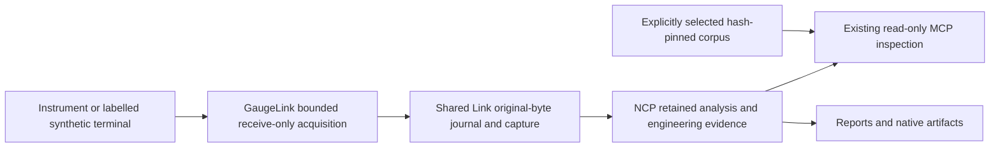

# GaugeLink, NCP and MCP system acceptance

GaugeLink and NCP must be qualified as an installed pair. A GaugeLink suite run against an older local NCP wheel does not qualify a separately published NCP branch. The 2026-10-07 audit reproduced that mismatch from the published source: bounded acquisition and retained measurement/reference/pinwheel APIs were absent from NCP even though GaugeLink depended on them. Missing required native modules now fail integration tests when NCP is installed.



GaugeLink owns instrument presentation and acquisition configuration. Shared Link owns capture, retention and delivery. NCP owns native analysis, evidence and result identities. MCP reads frozen selected inputs; corpus text and tool discovery never grant execution or admit evidence.

## Reconciled implementation

- The existing native device, measurement, reference and pinwheel modules are included with their source contracts, reference fixtures and qualification gates. Existing schemas, numerical operations and authority checks remain authoritative.
- The shared serial receiver validates duration, byte, chunk, record, idle and cancellation bounds. It retains exactly the consumed bytes and preserves the unread suffix. Permission checks occur before device opening, configuration and each read, including after readiness waits.
- Read-only journal inspection freezes an already closed, checkpointed source into a bounded private copy. Live WAL, SHM or rollback-journal sidecars cause refusal; inspection does not silently omit uncheckpointed records or create SQLite sidecars alongside retained originals. No acquisition or recovery is initiated by inspection.
- MCP validates request identifiers before parameter-error responses. Malformed objects cannot masquerade as notifications. Corpus compilation enforces its aggregate byte budget during loading.
- GaugeLink validates whether a claimed size-bound stop actually reached its selected byte or chunk bound. Native artifact export uses the existing NCP artifact contract; the legacy data-source wrapper remains a separately available interface.

## Reproduce with exact packages

Build wheels from the selected Git revisions and install both into a fresh environment with the declared dependency pins. GaugeLink's installed integration workflow pins an exact NCP commit and tests the complete installed product; its acquisition checker compares all installed package members to both wheels. Keep each wheel SHA256 with its test receipts because both projects currently use version 0.1.0.

From the GaugeLink checkout, under the isolated installed interpreter:

```text
python -I scripts/check_acquisition_installed.py --net-wheel <exact-ncp.whl> --product-wheel <exact-gaugelink.whl> --output-dir <new-acquisition-directory>
python -I scripts/check_reference_design.py --net-wheel <exact-ncp.whl> --output-dir <new-design-directory>
```

The acquisition check creates three labelled synthetic captures, exercises native analysis and replay, reconstructs original bytes and checks read-only MCP refusals. The design check is an ideal-wire topology model with fault injection, not an electrical, thermal or EMC solver.

From the NCP checkout, the existing `scripts/check_ncp_integrated.py` checks an independently pinned historical producer and golden journey, including source inspection, permission refusal, compile/run, recovery and real MCP processes. `scripts/check_ncp_corpus.py` checks actual installed mixed inspection with a pinned bundle and workspace. Both refuse output inside retained inputs. Their CLI help lists the required source references; generated corpus, local receipts and protocol transcripts are excluded from publication.

Additional regressions cover modeled stream fragmentation, cancellation, idle timeout, disconnect, grant expiry, malformed RPC, bounded corpus loading and unchanged read-only source directories. Simulation inputs retain their synthetic origin; they are not substituted for acquired instrument data.

## Qualification limits

Local installed results and hosted CI are separate evidence. GitHub Actions was blocked before runner startup by account payment/spending-limit state during this audit; local verification does not mark those checks passed. Platform-specific Linux PTY tests require a real Linux runtime and remain explicit when not executed on Windows. Optional native-provider or data-export profiles require their own declared installations and receipts.

On the audited Windows host, deeply nested output paths failed when recording filenames reached 261 or 266 characters. The same 376-case engineering/recovery group passed with a shorter fresh temporary root. Use a short output root on this host; arbitrary Windows path lengths have not been qualified. The original failures and independent long-path reproduction remain in the local audit evidence.

No assembled GaugeLink unit, calibration chain, electrical isolation, safety testing, EMC measurements or product certification is established by these software checks. Valid arithmetic can coexist with EVIDENCE_REQUIRED, ANALYSIS_UNRESOLVED, REQUIREMENTS_NOT_MET or physical qualification HELD. Those outcomes are preserved throughout the system.
