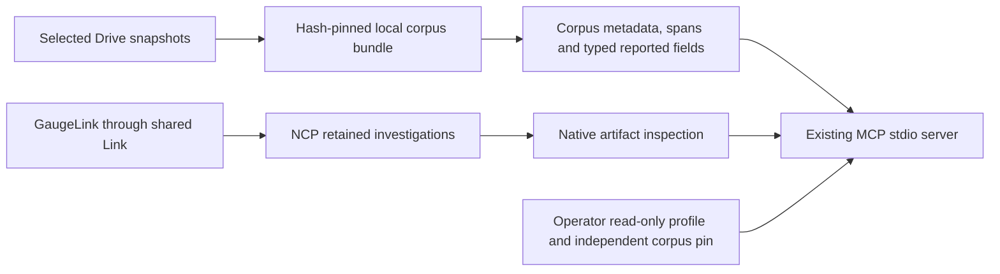

# NCP system and Proto-Corpus integration candidate

This local candidate combines the hardened NCP investigation/runtime boundary with
the existing selected Proto-Corpus retrieval modules. It adds normal `ncp corpus`
and `ncp agent` entrypoints and an optional combined read-only MCP launch. It
reuses the existing Session, artifact identities, source readers, native records
and MCP transport. Scientific operations retain their existing explicit grants;
retrieved material supplies context and never selects code or grants execution.

The real selected bundle contains 15 source records, three exposed internal
Markdown/JSON documents, 13 byte-located source spans and zero external full texts.
Five metadata files and all three exposed documents were downloaded afresh from
Drive and matched the retained originals byte for byte. Search is bounded lexical
retrieval over metadata and the three internal sources. Original rights/review
flags are preserved. The rest of the raw Proto-Corpus is outside this intake.

The source base is NCP feature revision
`26ffb9c06dec36c2357300b581fff7f415a1d1a0`, plus the preserved ncp8-hardened local
changes and this integration. NCP main was independently resolved as
`e6af2d48bfe7511185f6ebefa8cce7380cbc5d54`; it has separate README changes, so this
candidate is not described as merged main. GaugeLink source was not modified.

The built wheel keeps the existing version 0.1.0 and must be identified by its
SHA256: `2ff037ca9f0b01eb2bd4f2939c24c7534d0dd882046caf79f456c2f38b2cdd7a`.
All 443 packaged runtime members match both source and the isolated installation.
No private corpus data is packaged. The existing donor checkout is unchanged.

## Behavior and verification

- Malformed nested corpus metadata now refuses cleanly instead of raising
  AttributeError. Forty regression cases cover the defect without changing
  source identity, staging graph, rights or authority semantics.
- Combined MCP exposes eleven explicit inspection tools. Mutation and execution
  calls refuse even when called directly. It verifies and freezes corpus inputs,
  then validates a single frozen native profile before opening native inputs.
- A fresh process loads fixed installed offline Link scalar validators so it can
  inspect retained GaugeLink results without restoring executable operations.
- Real installed stdio tests exercised both 2025-11-25 and 2025-06-18: 70 responses
  per connection, exact reconstruction of all three source documents, eight typed
  reported fields, unchanged historical result/execution IDs, and denied mutation.
- Official Python MCP SDK 1.26.0 independently initialized the installed server,
  enumerated eleven tools and passed seven calls, including a denied execution.
- Existing installed GaugeLink/NCP acceptance passed 57 commands and 12 MCP
  processes across valid, interrupted and insufficient-context synthetic captures.
  The resulting evidence-required/unresolved states were preserved.

The detailed local evidence ledger at `.work/proto-corpus/REPORT.md` records the
initial failures, subsequent corrections, exact test counts, package checks,
commands, current launch configuration and patch identity. `.work/` is ignored
by Git because it contains local corpus snapshots and protocol transcripts.
The Windows/Linux CI workflow adds synthetic source and installed-wheel corpus
gates; remote CI has not been run for this uncommitted candidate.

The final affected installed-test ledger contains **746 passing cases, zero
remaining failures/errors, and 20 explicitly skipped optional FlowState cases**.
This combines the initial run and targeted correction reruns without double
counting. Corpus/MCP integration accounts for 184 passing cases with no skips.
It is not a full-repository or optional-native-provider qualification claim.

Eight initial failures were resolved: Windows ACL checks replaced invalid POSIX
mode-bit assumptions, and the isolated offline pip environment now obtains the
required SystemRoot through a fixed Windows API while excluding caller Python,
pip, proxy and certificate settings. Certificate and hostname verification remain
enabled. The qualifier carries its test helper into copied test environments;
Windows-specific tests have a separate CI target so the Linux no-skip gate stays
meaningful. Native package runtime bytes are unchanged by these test/tooling fixes.

## Launch and next boundary

See [CORPUS_RETRIEVAL.md](CORPUS_RETRIEVAL.md) for the reproducible bundle and MCP
commands, and `examples/agents/corpus-inspection/profile.json` for the portable
empty native-input profile. The local evidence directory also contains a concrete
MCP client configuration bound to the verified bundle and retained investigation.
No active client configuration has been changed.

This is local software acceptance. It does not establish physical GaugeLink
safety/EMC compliance, calibration, certification, source authenticity, scientific
admissibility, or qualification of optional unavailable native providers. The
selected corpus does not yet provide approved external full-text extraction,
semantic embeddings or automatic evidence admission. The next corpus increment
is an explicitly selected, rights-reviewed extraction with source-byte locators
and reviewed relevance to an existing NCP investigation.
