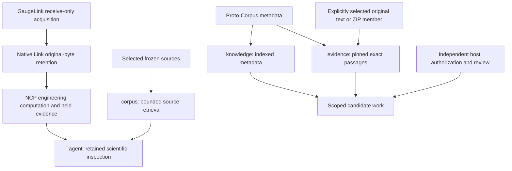

# NCP system profiles and retained authority

The common installed NCP package contains the retained engineering runtime,
GaugeLink's native Link interfaces, selected corpus readers, and the optional
knowledge/evidence/shared-work profile. These profiles use existing source and
result identities; combining them does not turn discovery into authorization.

## Profiles are explicit

| Command/profile | Inputs and outputs | Authority boundary |
| --- | --- | --- |
| `ncp agent`, `ncp corpus` | Retained native workspaces and selected corpus snapshots; eleven read-only mixed inspection tools | No execution grants, output directory or source-path selection from model tool arguments |
| `ncp knowledge`, `ncp evidence` | Pinned metadata catalog and optional frozen UTF-8 passages from selected files or ZIP members | Source bytes, metadata identities, representation identities and passage identities remain distinct |
| `ncp work` and scoped knowledge/work launchers | Host-bound requester/worker principals, approved contexts, proposals, leases and candidate submissions | Proposals and submissions are retained candidates; task authorization and result review are separate host operations |
| Native Link and engineering commands | Instrument observations, explicit computation, retained results and recovery | Acquisition is observational; computation requires explicit authority; recovery does not restore execution grants |

The knowledge profile may disclose a host-selected catalog without a work
principal. A scoped work launcher additionally enforces its existing principal,
role and investigation binding, including revocation on resource reads and tool
discovery. Neither profile accepts a model-selected local path, authenticates a
principal supplied as a tool argument, or grants itself a review decision.

An engineering review can be selected as exact source text and cited by a task.
Accepting the accuracy of that quotation does not change the engineering
review's unresolved checks, execution/result occurrence IDs or physical
qualification. `tests/test_ncp_profile_coherence.py` exercises this complete
boundary using the real engineering, evidence and task stores with explicitly
synthetic source identities and host decisions.

## Reconciliation provenance

This increment starts from NCP `fe558935452f7de699c79b7e35003e08b56b497e`
(PR #222, the previously qualified GaugeLink pair) and reconciles the scoped
36-path increment from PR #221 at
`70c515ba97b1b39693d9446626bf7879800efe03` (source tree
`ab43cdaa0c1d4926162e3dc347db6875ce8eaafb`). Their base histories differ, so the
reviewed source changes are reconciled explicitly rather than importing an
unreviewed ancestor tree.

The existing combined corpus host, early selected-source byte budget, malformed
JSON-RPC handling, receive-only bounds, journal snapshot guards and native Link
interfaces remain intact. New knowledge/evidence/work commands extend the
operator catalog and its coverage inventory. The common corpus fixtures exercise
actual Unicode bytes as well as the newer tamper regressions.

The optional transport dependencies are selected with `external-work`; they do
not become mandatory for native scientific inspection. The source and installed
combined suites run with the declared MCP SDK dependency. The original MCP
protocol boundary keeps its separately pinned client checks.

## Verification and limits

Build a wheel from the selected source revision and install it into a fresh
environment with `dev`, `external-work` and `legibility` dependencies. Run the
combined suites listed in `.github/workflows/ncp-system.yml` against the source
and the installed wheel. The installed gate runs from a fresh environment outside
the checkout, disables source-path injection, checks import locations and refuses
missing or skipped modules.

GaugeLink compatibility requires its own exact package-pair qualification; the
shared package version `0.1.0` alone is insufficient. Retain wheel hashes,
runtime-member inventories, selected input pins and test receipts with any
qualification result. See [GaugeLink system acceptance](GAUGELINK_SYSTEM_ACCEPTANCE.md)
for the acquisition and engineering checks.

JSON types are part of a pinned evidence contract. Integer `0` is not boolean
`false`, and integer `1` is not boolean `true`, even where Python equality would
consider them equal. Evidence reconstruction checks the canonical typed JSON
representation. Both corpus loaders enforce their aggregate input budgets during
loading, before reading later inputs or publishing an output.

Synthetic tests and simulations establish only the exercised software behavior.
Hosted CI, Linux device/provisioning coverage, remote authentication activation,
installed instrument identity, calibration, IEC safety/EMC assessment and physical
qualification need their own evidence. Corpus warnings and candidate results
remain source-reported material until the appropriate independent review.
