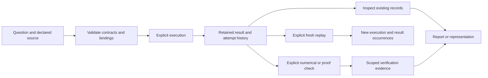

# NET operator manual

This manual accompanies the [system whitepaper](../README.md). It explains how
to install Notations Engineering Terminal (NET), execute bounded investigations,
read their evidence and move from synthetic examples to a declared industrial
workflow. The Python package is `ciw`; `net` is its composition and control CLI.
Existing `ciw` commands remain available.

An investigation starts with a question, source data and an explicit model. Its
result is a retained computational record with a stated scope. For industrial
use, the operator must also establish that the source, calibration, model and
operating conditions represent the installed process. NET provides interfaces
and records for that work; a successful software example does not complete it.

## 1. Choose an investigation

| Operator question | Start here | What the implemented path provides | Further requirements for a plant or product |
| --- | --- | --- | --- |
| Does this molding cycle meet declared dimensional tolerances? | `net polymer`; [polymer guide](POLYMER_PROCESSING.md) | Quantitative feature ingress, uncertainty intervals, separate conformity decisions, cooling/pressure reference estimates, retained reports and toy control simulations | Qualified measurements, applicable part condition/specification, calibrated uncertainty and a validated process model |
| What can calibrated sensor observations tell me about a system? | `net science`; [scientific workflows](NET_SCIENTIFIC_WORKFLOWS.md) | Workflow-specific calibration, time reconciliation, estimation, diagnostics and covariance transport | Exact provider bindings, required source contracts and installation-specific validation |
| Can a retained thermal model estimate core temperature? | [measured thermal guide](MEASURED_THERMAL.md) | Calibrated recording inputs, model estimates and held-out core-reference comparison | Recorded shell/power/ambient streams, independent reference data and model applicability |
| How can I change a model's structure without losing declared constraints? | `net rewrite`; [rewriting guide](HYPERGRAPH_REWRITE.md) | Bounded typed graph transformations, sum invariants, causal histories and explicit schedule comparison | A separate numerical model and evidence that the changed representation remains useful |
| How does a simple liquid system respond over time? | `net fluid`; [fluid guide](FLUID_DYNAMICS.md) | Two-reservoir/compliant-boundary and periodic linear-wave profiles with independent numerical checks | Geometry, material and operating-domain evidence; experiments for physical validation |
| Can I account for coolant or material discrepancies? | `net polymer leakage`; [leakage guide](leakage.md) | Retained balance calculations, joint covariance and replay through pinned FlowState kernels | Provider setup and defensible measured inflow, outflow and inventory evidence; a deficit alone does not identify a cause |
| How do I compose a coupled thermal/mechanical reference system? | `net system`, `net board`, `net compose`; [system composition](SYSTEM_COMPOSITION.md) and [workflow algebra](WORKFLOW_ALGEBRA.md) | Typed configurations, checked connections and existing numerical execution routes | Valid component models, parameters, coupling assumptions and physical validation |
| How do I plan daily irrigation under a pump budget? | `net irrigation`; [irrigation guide](IRRIGATION.md) | Bounded soil-water balance, observation holds, schedule and numerical audit | Calibrated field observations and local commissioning; the planner does not actuate hardware |
| Can someone independently check a particular computation? | [proved heat guide](PROVED_HEAT.md) | Registered integer heat execution, SP1 proof, retained bindings and fresh proof verification | Exact Linux build/runtime artifacts; a computation proof does not validate physical inputs or the model |
| Can I produce consistent views for people and software? | `net legibility`; [Legibility guide](LEGIBILITY.md) | Identity-bound representations and optional signed bundles | Applicable issuer trust and separate verification of the represented scientific claim |

For other domains, inspect [the instrument catalogue](INSTRUMENTS.md),
[integration coverage](INTEGRATION_COVERAGE.md) and `net catalog`. A catalog entry
is a navigation aid; each workflow owns its source schema, required providers,
validity domain and qualification gate.

## 2. Install and establish a baseline

Use Python **3.11 or newer**. Run installation commands from the repository
root. The root package declares pinned NumPy and WebSockets dependencies; the
21 imported instruments retain their own packages and runtime requirements.
Installing the root package does not install every instrument or native engine.

### Windows PowerShell

```powershell
py -3.12 -m venv .venv
.venv\Scripts\python.exe -m pip install .
.venv\Scripts\Activate.ps1
```

If activation is restricted, call `.venv\Scripts\net.exe` and
`.venv\Scripts\ciw.exe` directly. Alternatively use
`.venv\Scripts\python.exe -m ciw.net` and `.venv\Scripts\python.exe -m ciw`.
Changing the execution policy is unnecessary for these alternatives.

### Linux or macOS

```sh
python3 -m venv .venv
.venv/bin/python -m pip install .
source .venv/bin/activate
```

Use `python -m pip install -e '.[dev]'` for development. Add the `legibility`
extra when using signed representations: `python -m pip install '.[legibility]'`.
Other extras and native runtimes should be selected for their documented
workflow, rather than treated as a universal prerequisite.

### First use

```sh
net doctor --profile core
net catalog
net start --output-dir results/first-use-001
```

These commands have different meanings:

1. `doctor` checks local package and dependency metadata. Expected success is
   `preflight_passed`; its qualification remains `not_performed`.
2. `catalog` lists installed command surfaces and declared scientific provider
   requirements. It does not launch providers.
3. `start` executes bounded synthetic oscillator, thermal-observer and atmosphere
   workflows. It checks retained records and performs a fresh thermal replay.

Read `results/first-use-001/readiness.json` for `status: completed`, individual checks
and artifact paths. The receipt refers to `oscillator`, `thermal/original`,
`thermal/replay` and `atmosphere` beneath that directory. Preserve the complete
directory. A successful receipt covers the named checks on that installation;
additional provider and physical qualification remain specific to the task.

Use a **new output directory** for each run or replay. The examples below are
finite commands and do not start a persistent service, download a provider or
operate equipment. Most write commands use create-only destinations to preserve
prior investigations.

## 3. Three complete introductory investigations

### 3.1 Assess a synthetic polymer cycle

```sh
net polymer demo --process injection_molding --output-dir results/polymer-001
net polymer summary results/polymer-001
net polymer verify results/polymer-001 --output results/polymer-001-audit.json
net polymer replay results/polymer-001 --output-dir results/polymer-replay-001 --summary
```

Open `results/polymer-001/report/report.html`. The report directory also contains
`summary.json` and `measurements.csv`. The retained run contains `request.json`
and `workspace.json`. The CSV includes original samples and their declared
uncertainty/source references; joint covariance requires the retained native
artifacts rather than that marginal projection.

The fixture deliberately includes a nonconforming dimension. Successful
execution and numerical audit therefore coexist with a **NONCONFORMING** part
decision. Do not replace that decision with the overall workflow `PASS`.
Copilot context is deterministic evidence preparation, and the control result
comes from a toy plant.

To author a request separately, use:

```sh
net polymer example --process extrusion_blow_molding --output results/blow-request.json
net polymer run results/blow-request.json --output-dir results/blow-001 --summary
net polymer inspect results/blow-001 --summary
```

Review the generated declaration before changing it. Requests bind facility,
machine, tool, material, cycle and part identities; they also declare units,
clock/frame, acquisition times, uncertainty, part condition and tolerances.
Real retained observations must follow the ingress contract in the
[polymer guide](POLYMER_PROCESSING.md). Changing a source label from synthetic
to observed does not establish authentic acquisition or calibration.

### 3.2 Transform a thermal structure and check its invariant

```sh
net rewrite example --profile thermal --output results/thermal-request.json
net rewrite run results/thermal-request.json --output results/thermal-history.json
net rewrite inspect results/thermal-history.json
net rewrite verify results/thermal-history.json --output results/thermal-audit.json
```

The thermal example splits one declared zone into two and adds an interface.
It preserves the declared total heat capacity in `J/K` and declares interface
conductance in `W/K`. Inspect the original request, final graph and retained
history together. The example checks a structural invariant; it does not
calculate temperature or heat flux.

`COMPLETE` means the bounded transformation completed. `verify` replays its
transformations and writes a fresh verification occurrence. The
[rewriting guide](HYPERGRAPH_REWRITE.md) also provides bounded exploration and
comparison of two explicit schedules. A verified truncated exploration remains
incomplete, and agreement between two schedules does not prove global confluence.

### 3.3 Execute a bounded fluid model

```sh
net fluid example --profile reservoir --output results/reservoir-request.json
net fluid run --request results/reservoir-request.json --output-dir results/reservoir-001
net fluid inspect results/reservoir-001
net fluid verify results/reservoir-001 --output results/reservoir-001-audit.json
net fluid export-csv results/reservoir-001 --output results/reservoir-001.csv
net fluid handoff results/reservoir-001 --sample-index 0 --output results/reservoir-state.json
```

The reservoir profile evolves liquid exchange with hydraulic inertia/resistance
and one compliant spring/mass/damper boundary. It retains request, workspace,
verification and preservation records. The CSV exposes the finest retained
temporal resolution; a handoff selects just one sample and explicitly loses the
remaining trajectory and refinement traces.

`LOCAL` identifies the requested quantities qualified by the declared numerical
profile. `EXPAND` means additional physics is needed for a requested quantity;
`REFUSE` includes invalid declarations, domain violations and failed checks.
Read the reasons as well as the status. The exported state retains simulation
semantics and unestablished uncertainty. It does not acquire sensor data or run
the FlowState estimator. See [fluid dynamics](FLUID_DYNAMICS.md) for equations,
bounds, wave examples and the experimental validation path.

## 4. Work with recordings and a persistent session

For a finite recording-analysis example:

```sh
ciw demo --output recordings/demo.json
ciw analyze stats --recording recordings/demo.json --channel q --start 2 --end 8 --output-dir results/stats-001
ciw analyze spectrum --recording recordings/demo.json --channel q --start 0 --end 12 --output-dir results/spectrum-001
ciw inspect results/spectrum-001/workspace.json
```

The recording contains 768 synthetic damped-oscillator samples over `[0, 12)`
seconds. Statistics and spectrum analysis use its retained arrays. Inspecting
the saved workspace does not execute either analysis again.

For interactive work, start the loopback service explicitly:

```sh
net workbench --output-dir results/workbench --port 8765
```

Keep that terminal open. In a second terminal using the same environment:

```sh
ciw health
ciw send session.get
ciw send analysis.stats
ciw send result.list
ciw send workspace.save
```

`analysis.stats` creates a new execution and result. Save a checkpoint before
stopping the service with Ctrl+C. Restarting `net workbench` with the same
directory reopens the retained session. To use a different port, pass the
corresponding `--url ws://127.0.0.1:PORT` to client commands. The
[quickstart](quickstart.md) explains selection revisions and optional Godot
connection; the [protocol](PROTOCOL.md) specifies request contracts.

## 5. Bind a specialist scientific workflow

Start with discovery and a read-only provisioning plan:

```sh
net science catalog
net science catalog covariance --json
net provision --monorepo . --workflow calibrated-observable --plan
```

When that workflow is selected, the following explicit operation creates its
public provider checkouts and a bindings file outside the monorepo working tree:

```sh
net provision --monorepo . --workflow calibrated-observable --output-dir ../net-providers/calibrated-001
```

Provisioning uses retained Git history and exact execution pins. It does not
install provider dependencies, compile engines or execute the scientific
operation. Keep the source monorepo available at its original path because the
provisioned checkouts share its Git objects. Consult the
[calibrated-observable guide](CALIBRATED_OBSERVABLE.md) for dependency closure and
input requirements before running the workflow.

Create an independent synthetic investigation context, then run the selected
source through the existing scientific adapter:

```sh
net demo --output-dir results/context-001
net science run --workspace results/context-001/workspace.json --kind calibrated-observable --source examples/calibrated-observable/source.json --label reservoir-demo --bindings-file ../net-providers/calibrated-001/bindings.json --output-dir results/calibrated-001
net science inspect --workspace results/calibrated-001/workspace.json
```

The context's oscillator recording does not become measured evidence for the
new scientific operation. Use the actual `bundle_id` returned by the run when
selecting a bundle, requesting typed state or performing fresh replay. Keep
ordered upstream identities when required by the source contract; do not
substitute whichever result happens to be newest. Exact replay flags and
workflow-specific bindings are documented in
[scientific workflows](NET_SCIENTIFIC_WORKFLOWS.md).

## 6. Understand records, replay and evidence



| Identity or action | Meaning |
| --- | --- |
| Evidence or content identity | Identifies the retained source or content commitment. A digest checks byte consistency, not source authenticity or physical truth. |
| Operation identity | Names a versioned computational contract. |
| Execution identity | Identifies one attempt to perform that operation. Failed attempts can remain part of the investigation. |
| Result identity | Identifies an output occurrence bound to its execution and source. |
| Verification identity | Identifies the relevant verification record; its scope and lifecycle are workflow-specific. |
| Reopen / inspect | Reads and validates saved structure and provenance. It does not silently bind saved provider paths or rerun the original experiment. Some native readers recompute bounded consistency references. |
| Verify | Performs the selected workflow's documented check. Polymer and fluid issue fresh audit identities; rewrite verification replays transformations; atmosphere/impact diagnostics preserve their existing scientific verification identity. |
| Replay | Explicitly performs a new execution with new occurrences. Original evidence may remain identical; matching results do not make the replay independent validation. |

Retain the complete run directory, including its workspace, original request,
artifacts, audit receipts and failure records. An HTML report, screenshot or CSV
projection may omit covariance, assumptions or lineage. Retained JSON and native
artifacts remain necessary for detailed inspection and reproduction. Changes to
inputs should create a new investigation or use the documented
[correction loop](CORRECTION_LOOP.md); do not edit old result bytes to represent a
new conclusion.

### Interpret uncertainty and decisions in context

- Preserve quantity ordering, units, frames, clocks and the **full covariance**
  whenever the native contract supplies it. Variances alone lose correlations.
- Distinguish raw readings, calibrated measurements, model estimates, simulated
  states and caller-declared reference values. These labels carry different
  meanings even when their numbers coincide.
- Read missing-data, stale-data, alignment, model-inconsistency and held/refused
  diagnostics before using a result. A refused execution has no substitute
  successful estimate.
- Treat an uncertainty multiplier, acceptance bound or tolerance as a declared
  input unless its supporting qualification is retained. A computed interval
  alone does not establish empirical coverage or traceability.
- Separate computational completion, numerical agreement, part conformity,
  physical validation, evidence admission and equipment authority. A check of
  one does not supply the others.

The [model-validity and evidence guide](MODEL_VALIDITY_AND_EVIDENCE.md) explains
the distinct claims and the evidence needed to extend a model's scope.

## 7. Optional proof, representation and hardware paths

**SP1.** The implemented proved-heat path runs a registered integer Jacobi guest,
checks its native/guest commitments and produces a real SP1 CPU proof. Fresh
verification checks retained proof bytes against the registered guest using an
explicitly bound verifier. It is optional and separate from ordinary NET
execution. The pinned build recipe requires Linux; native Windows can inspect
retained records. Use the exact source, host, guest and compiler identities in
[proved heat](PROVED_HEAT.md). Proof replay creates another proof and may take
substantial time. Inspection of a saved success report is not fresh cryptographic
verification. The temperature-specific SP1 guest and PINN/gPINN comparison remain
programme work; the existing integer heat proof does not certify a thermometer,
continuous PDE solution or industrial temperature estimate.

**Signed representations.** Install the `legibility` extra and follow
[Legibility](LEGIBILITY.md). Demonstration signing keys demonstrate mechanics;
organizational trust requires an independently established issuer and trust
anchor. A valid signature authenticates the bound signed statement under that
trust arrangement, rather than establishing its scientific truth.

**Native engines and views.** Julia, native DSP, Blender, Godot, Bevy and other
specialist engines retain their documented host and runtime requirements. Their
source presence in this repository does not supply a built engine. See
[operator readiness](OPERATOR_READINESS.md), [technical reference](../TECHNICAL_REFERENCE.md)
and the relevant instrument guide.

**Physical instruments and control.** Current synthetic examples do not acquire
from a camera, access a PLC or commission a production machine. Actual hardware
requires the selected acquisition path, calibrated devices, installation records
and qualified adapters. Polymer control simulation is a toy plant. Temperature
measurement has separate [qualification](TEMPERATURE_QUALIFICATION.md) and
[product-conformity](TEMPERATURE_PRODUCT_CONFORMITY.md) planning paths. Local
workbench operation does not establish remote authentication, multi-user service
readiness or hard real-time control.

## 8. Troubleshooting and next steps

| Symptom | Interpretation and next action |
| --- | --- |
| `net` is not found | Activate the installed virtual environment, use its executable directly, or run its Python with `-m ciw.net`. |
| `doctor` fails | Read the named failed checks and expected/observed versions. Install the selected package/extras in the same environment. A source checkout alone may lack installed distribution metadata. |
| Output already exists | Preserve that record and choose a fresh destination. For a persistent workbench, reuse its directory only through the documented reopen path. |
| Provider is unavailable or its pin differs | Read the workflow's exact requirements, provision the appropriate checkout and bind it explicitly. Do not substitute a newer revision to obtain a success flag. |
| A synthetic cycle is `NONCONFORMING` | Read the tolerance decision: the polymer demonstration intentionally includes this result. Numerical audit success and part conformance answer different questions. |
| `INDETERMINATE`, held result or model inconsistency | Inspect missing/stale observations, frames/clocks, condition, covariance and model diagnostics. Supply the required evidence or revise the declared scope. |
| Rewrite is `TRUNCATED` | Inspect the reported budget and retained coverage. A valid retained history does not imply an exhaustive search. |
| Fluid reports `EXPAND` or `REFUSE` | Inspect the requested quantity, model domain, resolution and check failure before adjusting a declaration. Wider tolerances do not add missing physics. |
| Reopen fails after records changed | Preserve the failed attempt and compare against the original archive. Restoring consistent records is distinct from rerunning a changed request. |
| SP1 artifacts are missing on Windows | Retained inspection remains available; provision the documented Linux proof environment before attempting execution or fresh proof verification. |

For a compact installation path, use [quickstart](quickstart.md). For additional
public-tool examples, use [RUN_NET](RUN_NET.md). For operator gates and provider
provisioning, use [operator readiness](OPERATOR_READINESS.md). For protocol and
extension work, use [PROTOCOL](PROTOCOL.md), [integration coverage](INTEGRATION_COVERAGE.md)
and [development checks](DEVELOPMENT.md).
