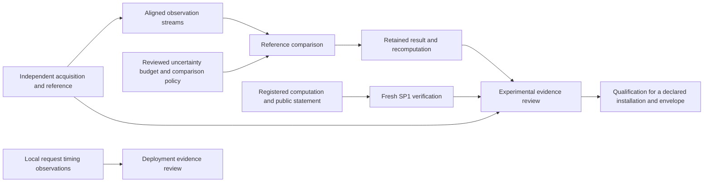

# Qualification progress: executable checks and remaining gates

NET's computation, experimental validation, equipment authority and deployment
qualification are different claims. This increment adds two mechanisms needed
to collect better evidence: uncertainty-aware paired reference comparison and
bounded local transport timing. It does not promote either result to physical
qualification, hard real-time certification or a privacy guarantee.

The existing [temperature pilot protocol](TEMPERATURE_QUALIFICATION.md) remains
the experimental plan, with a [literature-based industrial setup and readiness
inventory](TEMPERATURE_PILOT_READINESS.md). A separate
[PMMA feasibility proposal](TEMPERATURE_PILOT_CANDIDATE.md) develops a slower
metrology study with explicit sensing, reference and uncertainty requirements.
It complements the selected pilot without replacing its material or targets.
Published facts and proposed choices remain separate from the missing
installed-chain measurements.

| Limitation | Executable progress in this increment | Next evidence required |
| --- | --- | --- |
| Numerical results do not validate physical equipment or models | Paired observations, an explicit joint uncertainty budget and recomputable guardbanded comparison | Independent physical trials and review of acquisition, calibration, installation, model applicability and uncertainty completeness |
| Research operations have bounded contracts | A new scalar comparison contract handles up to 64 aligned pairs; unsupported or incomplete evidence cannot silently become a pass | Extend each required provider/profile with explicit domains, resource bounds and positive/negative acceptance cases |
| No hard real-time or remote multi-user service | A bounded loopback timing campaign retains successes, errors and budget breaches | Target hardware timing qualification; a separately implemented authenticated service with per-principal authorization and isolation |
| SP1 proves a computational statement | Registered heat has a successful real Linux proof campaign at the linked revision; no additional proof profile is registered here | Separate registered guest contracts and genuine positive/negative proof campaigns for new statements; a qualified privacy design |



The diagram shows evidence dependencies, not automatic qualification. A human
review and authentic experimental records are external to the two new commands.
Content hashes detect changes; they do not authenticate a sensor or a reviewer.

## 1. Reference comparison with declared uncertainty

`net reference-compare` consumes a request containing two existing
`ciw.observation-stream.v1` scalar streams and a comparison policy. It requires
aligned sample instants, matching quantity/unit/time semantics and exact input
identities. It does not interpolate, convert units or silently align clocks.
The demo creates synthetic request files that show the complete input structure.

```sh
net reference-compare demo --case pass --output-dir results/reference-pass --summary
net reference-compare demo --case fail --output-dir results/reference-fail --summary
net reference-compare demo --case unknown --output-dir results/reference-unknown --summary
```

`--summary` presents the disposition, per-sample counts and reasons, paired-difference
limits and declared uncertainty scope in a short text report. The saved request
and report remain complete JSON. Omit the flag when piping command output to
another program. It is also available on `run` and `verify`.

For a supplied request, run the calculation and recompute its saved
report using the retained inputs:

```sh
net reference-compare run comparison-request.json --output comparison-report.json
net reference-compare verify comparison-report.json
```

For `run`, `verify` and `demo`, exit **0** means PASS, **2** means a valid FAIL,
**3** means INDETERMINATE and **1** means refusal. Verification of a faithfully
retained failed comparison still returns 2; it does not turn the decision into a pass.

Use fresh output paths. The policy explicitly supplies the absolute residual
limit, an uncertainty multiplier, a maximum standard uncertainty, the exact
input hashes, the covariance relationship and budget justification. The budget's
completeness and evidence references are operator declarations, not verified
calibration certificates. Unknown or conditional-only uncertainty cannot support
an unconditional comparison pass. Zero uncertainty must be explicitly declared;
missing uncertainty does not mean zero.

For paired scalar observations, let `d_i = x_i - r_i`. With joint covariance
blocks for the test stream, reference stream and their cross-covariance,

```text
C_delta = C_xx + C_rr - C_xr - C_xr^T
u_i^2   = (C_delta)_ii
w_i     = k * sqrt(u_i^2)
```

The uncertainty ceiling applies to the paired difference, not the absolute accuracy of either sensor. Shared errors can cancel in a difference; agreement alone does not establish accuracy against physical truth.

The complete joint matrix retains temporal correlations. Zero cross-covariance
is a substantive declaration requiring justification; the software never fills
an absent relationship with independence. A positive multiplier `k` specifies
the policy's interval width. It does not by itself establish a coverage probability.

For a declared symmetric allowable band `[-L, L]`, the decision is:

| Per-sample situation | Outcome |
| --- | --- |
| Complete declared budget, acceptable uncertainty and `abs(d_i) + w_i <= L` | PASS |
| Complete declared budget, acceptable uncertainty and the entire interval lies outside the band | FAIL |
| Interval overlaps a boundary, uncertainty exceeds its ceiling or budget is unknown/incomplete/conditional | INDETERMINATE |
| Missing observations or incompatible observation/time semantics | INDETERMINATE |
| Malformed inputs or invalid/inconsistently bound covariance | Refusal |

The calculation uses exact rational comparisons of the submitted binary64
numbers for the guardband decisions. Displayed interval endpoints round outward.
This prevents a rounded display value from turning an ambiguous boundary into a
pass; it does not establish the adequacy of the physical uncertainty model.
Verification recomputes the saved report rather than trusting its status field.

A campaign pass applies only to the submitted pairs. Correlated sample instants
are not independent experimental repeats; pointwise intervals do not provide
simultaneous campaign coverage or bounds between samples. The result does not
authorize equipment operation. Synthetic examples always remain physically
unqualified.

The [thermal recording workflow](MEASURED_THERMAL.md) retains input uncertainty
without propagating it through its kernel. Its posterior covariance is
conditional on that model. Do not label it a complete comparison budget merely
to enable a PASS. A physical pilot must account for omitted contributions or
retain an inconclusive result.

## 2. Bounded local timing evidence

With a local Workbench running, collect a short campaign:

```sh
net timing run --url ws://127.0.0.1:8765 --samples 5 --timeout 3 --budget-ms 50 --output timing-report.json --summary
net timing inspect timing-report.json --summary
```

`--summary` shows attempted/successful/failed sample counts, timeouts, the
successful-only percentile population and budget disposition. Missing or invalid
aggregates display as unavailable. The retained JSON is unchanged; omit the flag
for the existing machine-readable output. Input and file errors explain which
setting or path condition needs correction without echoing endpoint credentials.

The command uses read-only `session.get` requests. It measures client-observed
elapsed time for each fresh connection, including connection, protocol handling
and closure. It is not a kernel execution timer. The report retains attempted
samples, failures, successful-sample p50/p95/maximum, endpoint and session identity,
and an optional observed budget assessment. A failed request does not disappear
from the campaign merely because it has no successful timing value. A changed
session identity prevents treating the observations as one comparable aggregate.

The run exits **0** for a successful campaign within its optional observed budget,
**1** for failed samples, changed identity or an exceeded budget, and **2** for a
command/refusal error. `inspect` returns 0 for a structurally valid report even
when its retained campaign failed. Read `summary.status` for the campaign outcome.

Only loopback WebSocket endpoints are accepted by this initial profile. URL
credentials, query strings and fragments are refused. Sample count, per-request
timeout and total nominal request budget are bounded. Each write requires a fresh
path. The same 4,000,000-byte limit applies to publication and inspection, so
a published report can be reopened. Inspecting a report validates its structure and derived summary; it does
not remeasure the service or authenticate the retained timestamps.

An observed budget pass establishes only what happened during that campaign.
`hard_real_time_qualified` remains false. A client timeout is not cancellation of
a provider's computation. Scheduler interference, fault recovery, worst-case
execution time and production load need a target-specific design and evidence.

Remote multi-user support requires a separate service increment: authentication
before any snapshot is disclosed, authorization for each action and event,
principal/session isolation, TLS termination, bounded resource use and tests for
cross-user leakage, unauthorized mutation, reconnects and concurrency. The local
server's existing shared-session locking does not supply those properties.

### Diagnose an incomplete result

| Observation | Next action |
| --- | --- |
| Comparison is INDETERMINATE with unknown/incomplete budget | Review the missing contributions and cross-source relationship; retain unknown until evidence supports a complete budget |
| Comparison has incompatible quantity, frame or clock semantics | Correct the source mapping or implement a justified transformation; do not relabel coordinates or units to force agreement |
| Comparison exceeds its uncertainty ceiling or overlaps the allowed band | Inspect the retained per-sample intervals and budget; improve the measurement or revise the proposed design before a new predeclared trial |
| Timing has failed samples | Inspect failure counts and check that the local Workbench is available; timeout records remain part of the campaign |
| Timing identity changes | Start a new campaign on one unchanged session/run/evidence identity |
| Timing exceeds its observed budget | Review server load and host conditions; record another campaign in a fresh path after changes |
| Output already exists | Choose a new destination; preserve the previous report for comparison |

### Installed software acceptance

The [operator readiness workflow](../.github/workflows/operator-readiness.yml)
now runs the comparison/timing contract tests and a separate installed-package
command campaign on Windows and Linux. The latter checks all three comparison
dispositions, human summaries, tamper rejection, preservation of prior results,
live socket requests, observed budget breaches and retained timeouts. Its script
requires isolated Python and refuses editable/source-checkout imports:

```sh
python -I -B scripts/check_qualification_commands.py --output-dir results/qualification-commands
```

Install the wheel into a virtual environment outside the checkout first. The
script retains each command receipt and `qualification.json`, including failures.
A passing campaign covers these software paths on the tested installation; it
does not supply the physical pilot records.

## 3. Extend bounded workflows through qualification

Choose the next industrial requirement from an actual installation. Freeze its
input/output semantics, uncertainty treatment, numerical domain and resource
budget, then implement the provider binding and its independent reference checks.
Exercise unsupported values, missing providers and replay/tamper cases before
expanding the published envelope. Availability and experimental qualification
remain distinct statuses.

For the temperature pilot, the next non-software input is the installed sensor
and readout identity, calibration evidence, synchronized raw/reference recordings,
independent cycles, environmental envelope and predeclared acceptance rule. Use
the existing [pilot evidence matrix](TEMPERATURE_QUALIFICATION.md), then retain
comparison results alongside the original acquisition records. The new comparator
supplies a calculation, not those missing records or their approval.

## 4. SP1 computational scope and privacy

The registered [heat profile](PROVED_HEAT.md) has a successful
[Linux campaign on 2026-10-04](https://github.com/atomtrapping/Notations-Engineering-Terminal/actions/runs/37220769525)
at commit `68084b67`: **132 tests passed, with no skips**, including real proof
creation, replay/reverification, corrupted-proof rejection and input/output
rebinding rejection. The exact build/source checks, gate status and evidence
artifact are recorded in the [campaign record](evidence/proved-heat-2026-10-04.json).
This is concrete computational evidence for that pinned profile and revision.
It does not qualify new guests, physical models or arbitrary later changes.

[`scripts/check_proved_heat.py`](../scripts/check_proved_heat.py) and its pinned
[Linux workflow](../.github/workflows/proved-heat.yml) remain the acceptance gate
for affected changes. Retain build/source checks, the gate result and proof
bundles when rerunning it; skipped tests do not pass the gate. This increment
records the already completed campaign and does not claim a new local proof run.

An exact-affine guest candidate exists in the embedded compute runtime, but it
still needs its reproducible build, registered ELF and real positive/negative
proof tests. It does not prove the current temperature numerical audit: that
audit includes binary64-derived affine conversion, covariance and acceptance
rules. A temperature proof needs its own frozen arithmetic/rounding contract,
independent guest, registered build and tamper campaign.

The current retained proof path uses core proofs and retains source/input/output
bytes. SP1 distinguishes its non-zero-knowledge STARK proofs from its
zero-knowledge Groth16/PLONK implementations and their setup assumptions in the
[official security model](https://docs.succinct.xyz/docs/sp1/security/security-model). A privacy profile must separately define what an observer may learn,
select and qualify a zero-knowledge wrapper, restrict its public statement,
control witness storage/logging and test disclosures. Removing raw fields from
one JSON file does not establish privacy.

A future guest can check measurement-source signatures, certificate bindings,
policy versions and declared acceptance calculations. Such predicates improve
the specificity of the proved statement. They still depend on authentic external
observations and valid physical assumptions. SP1 verification cannot turn a false
measurement or an inapplicable model into physical truth.
