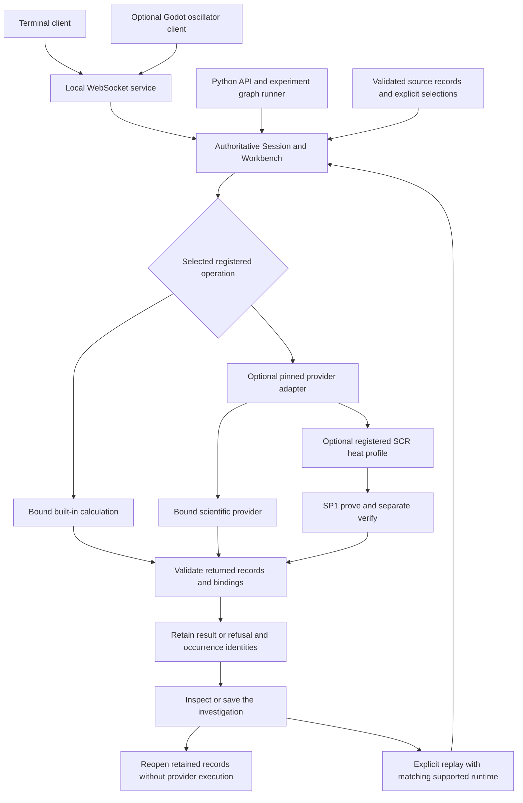
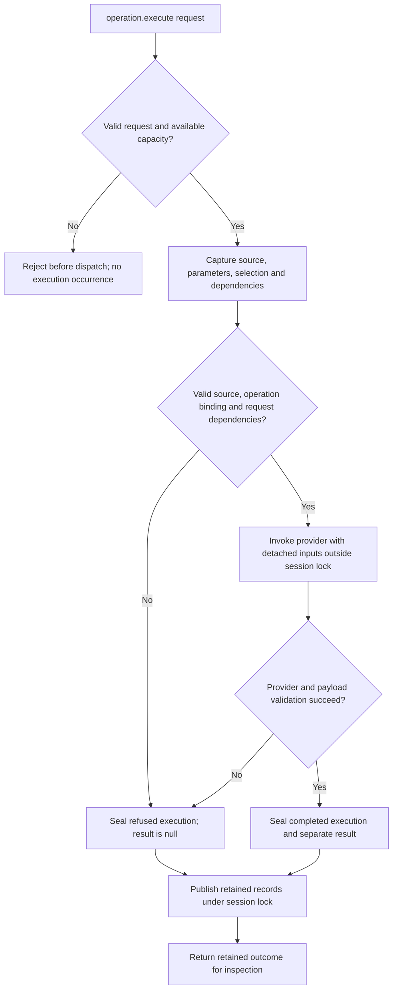
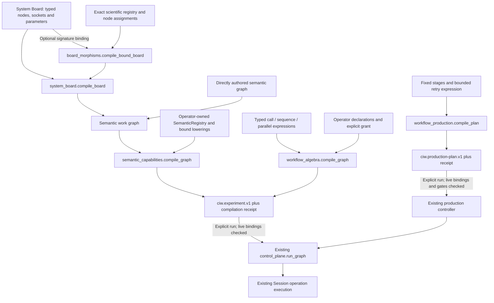
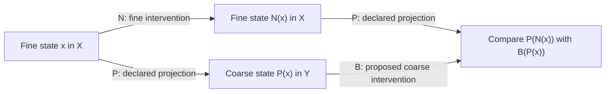
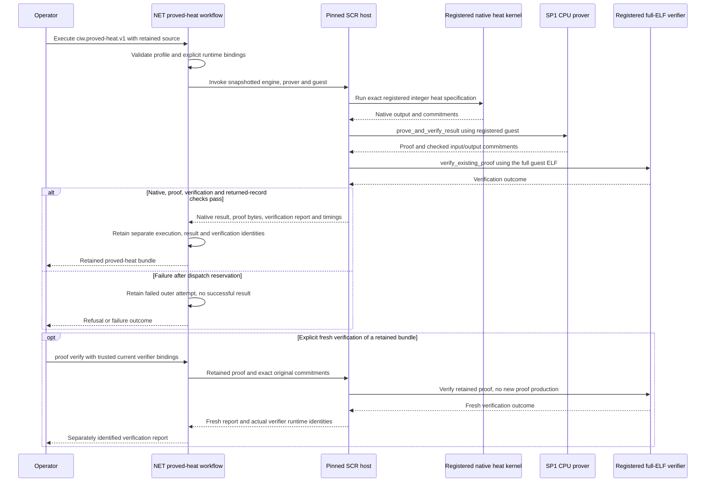

# System architecture and functional diagrams

This companion to the [paper and overview](../README.md) and
[operator manual](OPERATOR_MANUAL.md) maps the implemented Notations Engineering
Terminal (NET) to its mathematical and execution contracts. The Python package
and retained schemas continue to use `ciw`. The figures are editable Mermaid;
the linked source files define the executable behavior.

## Reading the figures

**Implemented** means a path exists in the checked-out source. **Optional**
means that the operator must select or provision that path; it is not a stage
traversed by every operation. **Conceptual** identifies a research interpretation
or intended extension, not a callable facility. A source-level implementation
claim is separate from the qualification of a particular provider, platform or
revision; see [integration coverage](INTEGRATION_COVERAGE.md).

Solid arrows in Figures 1–3 show implemented calls or record flow, with optional
branches labelled. Figure 4 is an explicitly mathematical diagram of the finite
checker. Figure 5 shows the separately provisioned proof lifecycle. None of these
arrows grants evidence admission, release or equipment-control authority.

## 1. The workbench and its providers

*Figure 1. Implemented operating architecture, with optional provider paths.*
NET owns invocation, inspection and retained investigation history. A provider
owns the numerical meaning of its operation. A request may use a built-in
calculation or a selected external profile; it does not pass through every
runtime or through SP1. The Godot client renders its supported oscillator view
contract. It is not a general front end for every provider.

The source/runtime pin, interpreter identity and execution limits belong to the
provider boundary. These controls detect identity drift and bound a subprocess;
they do not establish an operating-system sandbox or physical correctness.
Opening an investigation checks its content and dependencies. Replay is a new
execution and preserves the original history.

**Sources:** [executable architecture](ARCHITECTURE.md),
[execution responsibilities](EXECUTION_RESPONSIBILITIES.md),
[Session](../src/ciw/session.py), [Workbench](../src/ciw/workbench.py),
[pinned subprocess adapter](../src/ciw/adapters/subprocess.py),
[registered heat](PROVED_HEAT.md).

## 2. Request admission, execution and refusal

*Figure 2. The registered-operation runner's ordinary lifecycle.*
This figure summarizes the `Session` / `operations.runner.execute` branch.
Source validation, dependency checks and registered runtime identity checks
precede numerical execution. Once this branch accepts the request, an ordinary
provider or payload-validation failure is retained as a refusal. A successful
result starts with `verification_id: null` and `verification_status: not_verified`;
sealing its JSON does not create independent verification.

Native Workbench workflows, including proved heat, use their documented outer
attempt lifecycle: malformed requests, missing host bindings and capacity
rejection precede reservation; failure after dispatch reservation retains a
failed attempt with no result. A retained attempt alone does not establish that
a child runtime or prover started. Figure 5 adds the heat-specific proof checks.
Storage failure is also a distinct failure: this diagram assumes publication
succeeds, rather than promising that an unavailable filesystem retained a record.

**Sources:** [protocol](PROTOCOL.md),
[operation runner](../src/ciw/operations/runner.py),
[Session request handling](../src/ciw/session.py),
[shared native failure lifecycle](PROTOCOL.md#failed-native-workflow-attempts).

## 3. Typed authoring lowers into existing execution

*Figure 3. Implemented, optional authoring paths converge on existing contracts.*
The Board compiler uses `DATAFLOW` and `DEPENDENCY` edges for execution.
Semantic, spatial, temporal, authority and scale relations remain retained
non-execution structure. A Board operation names a semantic capability; the
operator-owned registry resolves it to an eligible bound implementation. The
installed semantic catalog currently binds statistics and periodogram analysis.
Compilation by itself invokes no numerical provider and authorizes no execution.

The optional scientific binding pins the Board, registry, morphisms and endpoint
representations. It checks every operation's signature and exact representation
identity along dataflow edges. It does not discharge textual scientific
preconditions or validate the physical meaning of a runtime payload.

The workflow algebra is a separate front end. Its typed dataflow checks schema,
unit, frame, clock, meaning and arity, as well as declared effects and grants.
Production composition instead establishes acceptance barriers between fixed
jobs. A barrier is not an automatic transfer of one job's output into another.
`parallel` expresses declared independence; the current runner executes
sequentially. These bounded implementations support a categorical interpretation
of typed composition, not a machine-checked universal category semantics.

**Sources:** [System Board](SYSTEM_BOARD.md),
[semantic capabilities](SEMANTIC_CAPABILITIES.md),
[workflow algebra](WORKFLOW_ALGEBRA.md),
[Board morphism binding](FINITE_REPRESENTATION_PRESERVATION.md#1-board-to-morphism-binding),
[graph runner](../src/ciw/control_plane.py).

## 4. Representation, measure and intervention preservation

*Figure 4. The finite checker evaluates whether this square commutes at every
declared state, including states with probability zero.* The arrows are total
caller-supplied finite maps, not numerical-provider calls or physical commands.
The required equality is

$$
P\circ N=B\circ P,
\qquad P(N(x))=B(P(x))\quad\text{for every }x\in X.
$$

For the separately declared probability distribution and observable, the same
checker computes the pushforward and positive-mass conditional means:

$$
p_Y(y)=\sum_{P(x)=y}p(x),\qquad
\mathbb{E}[f\mid P=y]=
\frac{\sum_{P(x)=y}p(x)f(x)}{p_Y(y)}.
$$

This is an implemented use of finite measure-theoretic constructions with exact
rational arithmetic. The record retains fibres, conditional variances, failing
states and conflicting fibres. Zero-mass conditional quantities remain undefined.
Equal output distributions or preserved averages do not substitute for the
state-level equality in the diagram.

The implementation accepts 1–64 explicitly labelled states per space and
bounded rational inputs. Its witness concerns that declared finite model.
`require_finite_local_support` also requires an explicit supporting contract; it
does not create a Needle plan, choose an optimal representation, recover empirical
states or supply a continuous-signal theorem. General task-sufficient
representations remain a research direction beyond this finite check.

**Sources:** [finite preservation contract and counterexample](FINITE_REPRESENTATION_PRESERVATION.md),
[exact evaluator and witness validator](../src/ciw/finite_preservation.py),
[representation contracts](../src/ciw/representation_morphisms.py),
[finite regressions](../tests/test_finite_preservation.py).

## 5. SP1's selected computational proof lifecycle

*Figure 5. Optional, implemented SP1 path for the registered integer heat
profile.* The sequence requires provisioned compatible artifacts; the documented
reproducible guest build requires Linux. An earlier failing stage stops the
creation path before subsequent stages. The first prove call includes SCR's
proof check; NET additionally invokes the separate retained-proof verifier.

The claim concerns execution of the registered integer Jacobi update, bound to
its input/output commitments and guest ELF. The profile has 3–32 cells, 0–64
steps, values bounded in magnitude by `2^40`, fixed endpoints and unit `1`.
Source/ELF correspondence and proof-system soundness remain assumptions. It does
not prove arbitrary Julia, Rust or industrial computations, establish calibrated
temperature, validate a physical heat model or authorize an equipment command.

Opening the bundle checks retained content and linkage without running the
cryptographic verifier. Its historical report is explicitly marked as requiring
fresh verification. `proof verify` verifies the retained proof; replay performs
a new execution and produces another proof. The outer session retains failures
without silently replacing the selected proved operation with an unproved result.
The separate exact-affine checker/guest extension has its own pending genuine
proof gate and is not covered by the registered heat profile or its gate.

**Sources:** [proved heat operation and acceptance gate](PROVED_HEAT.md),
[workflow implementation](../src/ciw/proved_heat.py),
[execution responsibility allocation](EXECUTION_RESPONSIBILITIES.md),
[Linux proof workflow](../.github/workflows/proved-heat.yml),
[genuine proof gate script](../scripts/check_proved_heat.py).

## 6. Function and module responsibility map

| Function or module | Responsibility | Boundary of the claim |
| --- | --- | --- |
| [`core/`](../src/ciw/core/) | Scientific-record structure, content identity and covariance artifacts | Structural validity does not infer calibration or physical truth. |
| [`Session`](../src/ciw/session.py) | Capture selection, invoke operations, publish records, save/reopen investigations | Owns workbench session history, not every subsystem's canonical state. |
| [`operations.runner.execute`](../src/ciw/operations/runner.py) | Invoke a bound operation and seal completed or refused execution | A successful result is not automatically verified. |
| [`PinnedSubprocessAdapter`](../src/ciw/adapters/subprocess.py) | Source/runtime checks and bounded external invocation | Identity/time/output controls are not an OS sandbox. |
| [`control_plane.run_graph`](../src/ciw/control_plane.py) | Preflight and run a bounded sequential operation DAG through Session | Refused/error nodes block descendants; independent nodes may continue. |
| [`SemanticRegistry` and `compile_graph`](../src/ciw/semantic_capabilities.py) | Resolve declared meanings to bound lowerings and emit an ordinary experiment | Operator-owned resolution; no execution grant from compilation. |
| [`system_board.compile_board`](../src/ciw/system_board.py) | Lower executable Board nodes and edges through the semantic plane | Other relational edges remain descriptive. |
| [`board_morphisms.bind_board` / `compile_bound_board`](../src/ciw/board_morphisms.py) | Bind scientific signatures to exact Board and registry content | Signature agreement does not prove scientific payload semantics. |
| [`workflow_algebra.compile_graph` / `run_compiled`](../src/ciw/workflow_algebra.py) | Check typed composition, declarations and live grant before the existing runner | Bounded composition and regression-tested laws, not universal closure. |
| [`workflow_production.compile_plan` / `run_compiled`](../src/ciw/workflow_production.py) | Compile fixed stage barriers and bounded retries into the existing controller | Fixed checks and prerequisites remain; missing evidence holds. |
| [`finite_witness_from_spec` / `validate_finite_witness`](../src/ciw/finite_preservation.py) | Evaluate and recompute exact finite preservation witnesses | Applies to the supplied finite model and exact registry. |
| [`ProvedHeatWorkflow`](../src/ciw/proved_heat.py) | Produce, retain, replay and freshly verify the selected heat proof profile | Computational statement about the registered guest, not physical validity. |

The broader **state + representation + morphism + invariant** formulation
organizes these contracts. Evidence, canonical state, representations, execution
results and verification remain distinct identities and responsibilities. The
current bounded bindings and finite witnesses do not implement every part of
that research architecture. See [research context](RESEARCH_CONTEXT.md),
[foundations and attribution](RESEARCH_FOUNDATIONS.md) and the
[executable architecture](ARCHITECTURE.md) for its explicit status boundaries.
