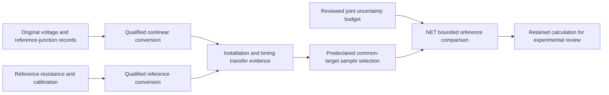

# Complementary metrology study: local PMMA temperature during slow heating

**Status: a sourced design proposal, not an installed or qualified measurement
system.** No hardware serial number, calibration certificate, specimen lot or
experimental result has been supplied. All numerical pilot requirements below
are proposed engineering choices unless explicitly labelled as published facts.
The companion [planning record](../examples/temperature/pilot-candidate.json)
is non-executable and describes a complementary feasibility study.

The selected industrial pilot remains the Rodrigues-based polycarbonate
apparatus recorded in [pilot-setup.json](../examples/temperature/pilot-setup.json)
and explained by the [readiness guide](TEMPERATURE_PILOT_READINESS.md).
That plan already contains literature-backed choices; actual hardware,
calibration and installed evidence remain missing. This PMMA proposal does not
replace its material, apparatus, envelope or acceptance targets. It offers a
slower laboratory study of metrology and software handoffs whose methods could
inform that pilot, without transferring qualification between installations.
The [public dataset assessment](POLYMER_TEMPERATURE_DATASETS.md) remains the
broader source-selection guide; the PMMA file inspection below supplements its
earlier catalog-only assessment.

This separate candidate uses a different planning schema and is not an input
to `ciw.temperature_readiness`, which checks the selected industrial setup.
Neither plan authorizes procurement or equipment operation.

## Purpose and published basis

For this complementary study, propose one PMMA coupon in an air chamber, heated
from 25 to 80 °C. The proposed target is the one-second mean temperature at the instrumented
slab's midplane centre. Finite probe sensing volumes require an explicit spatial
transfer to that target. This is local temperature in that instrumented specimen,
not chamber setpoint, undisturbed bulk material, a field reconstruction or a
moulding-process qualification. This modest initial envelope supports checking
acquisition, reference comparison, installation effects and uncertainty before
attempting faster or hotter industrial cycles.

The MaCFP material record identifies nominally 6 mm black cast PMMA, ACRYLITE
cast black 9H01 GT. NIST's separate gasification experiments used approximately
70 mm diameter discs and measured back-surface temperature with Type K
thermocouples of 0.125 or 0.25 mm wire diameter. Those were radiant pyrolysis
tests, not the proposed low-temperature chamber experiment.
[Material record](https://github.com/MaCFP/matl-db/blob/2a7d54d057329172d49869efae55363b8d182caa/PMMA/README.md);
[NIST setup, “Test Overview” and “Sample Information”](https://github.com/MaCFP/matl-db/blob/2a7d54d057329172d49869efae55363b8d182caa/PMMA/Validation_Data/NIST_Gasification_Apparatus/README.md#sample-information).

NIST describes comparison of a Type T thermocouple against a platinum resistance
thermometer in a stirred bath. Its readout example uses a 100 mV voltmeter range
with a tolerance of 4 ppm of reading plus 0.3 µV; that is an illustrative
uncertainty calculation, not a specification of an instrument owned by NET.
[Ripple and Garrity, sections 3 and 3.4, PDF pages 3–4](https://tsapps.nist.gov/publication/get_pdf.cfm?pub_id=830933#page=3).

## Proposed specimen and instrument requirements

The following is one candidate design to assess for feasibility. It is not a
purchase list or a claim that compatible equipment is available locally.

| Item | Proposed requirement | What must establish suitability |
| --- | --- | --- |
| Specimen | Black cast PMMA disc, nominal diameter 70 mm and thickness 6 mm; target the published grade if obtainable | Actual supplier/grade/lot, thickness map, history and material compatibility; substitutions get their own identity |
| Sensing element | Type T welded junction, nominal 0.125 mm wire; retain wire lot and junction dimensions | Inspection, repeatability, inhomogeneity, drift and installed conduction assessment |
| Thermocouple readout | Calibratable DC mV input, 100 mV range, resolution at most 0.1 µV, input resistance at least 10 MΩ; record individual channel acquisition times | Actual model/manual, input loading, noise, offsets, scanner thermal EMFs, range calibration and channel skew |
| Reference junction | Characterized ice-point junction assembly for the initial laboratory campaign | Preparation, immersion/stability and actual junction temperature uncertainty; an electronic compensation block is a later separately characterized alternative |
| Static reference | Calibrated four-wire PRT plus its own resistance bridge/readout | Current certificate, range, calibration function, readout contribution, self-heating, drift and immersion tests |
| Dynamic reference candidate | Four-wire PRT with documented sheath diameter at most 1 mm and sensitive length at most 3 mm | A physically suitable calibrated probe must be identified; neither its availability nor installed response is established |
| Heating | Programmable air chamber with independent temperature control and bounded 25–80 °C programme | Chamber uniformity/stability survey, actual ramp tracking, operator procedure and separately authorized equipment interface |
| Acquisition | Retain voltage, reference-junction observations, PRT resistance and timestamps at nominal 1 Hz | Original file bytes, clock identity, measured skew and missing/saturation flags; no hard real-time claim |

The proposed one-second mean requires matched, documented integration windows
or a qualified averaging procedure for both channels. A 1 Hz logging cadence
alone does not establish that mean. Retain aperture, filter/averaging settings,
window start/end times and timestamp convention. If the instruments cannot
support that temporal measurand, revise it before collecting the comparison;
do not relabel instantaneous or differently averaged readings as matched means.

The voltmeter performance class follows the published comparison-calibration
method; the resolution, geometry and acquisition requirements are our choices.
NIST's current service table lists IPRT comparison calibration uncertainty of
2.4 mK (`k=2`) from 0.5 to 95 °C, but explicitly excludes digital-readout
uncertainty. This is context for reference selection, **not our PRT's uncertainty
or evidence of calibration**.
[NIST industrial thermometer calibrations, uncertainty tables and footnote](https://www.nist.gov/pml/sensor-science/thermodynamic-metrology/industrial-thermometer-calibrations).

## Static calibration first; installed comparison second

First characterize the complete thermocouple/readout chain and the reference
in a stirred bath at proposed points 25, 40, 55, 70 and 80 °C, in ascending and
descending order, before and after the chamber campaign. Verify immersion,
bath gradients, reference stability and electrical offsets. A plateau is accepted
only under a predeclared stability criterion; a scheduled wait alone is not
evidence of equilibrium. The static reference need not fit inside the polymer.

The dynamic fixture is a **feasibility gate**. Proposed geometry is two parallel
bores reaching the coupon midplane, with probe centres separated laterally by
2 mm and measured placement uncertainty targeted at 0.2 mm. A PRT of at most
1 mm diameter can fit within a 6 mm slab geometrically; stem conduction, sensitive
length, drilling damage and contact material may still make this unsuitable.
Document a section drawing and inspect an instrumented sacrificial coupon.
If a suitable miniature reference cannot be calibrated and installed, complete
the static stage and retain dynamic qualification as unavailable.

The two probes observe different physical locations. Keep their actual location
and frame identities. Before comparing values as estimates of one common target,
establish a transfer model or justified negligible-gradient approximation with
uncertainty for separation, gradients, lag, stem conduction, contact, insertion
disturbance and timing. Position swaps and additional gradient observations
should test that model. Do not change frame/entity names merely to satisfy NET's
matching-field checks. Any transfer is an explicitly retained derivation with
its own evidence and dependencies; this increment does not implement it.

## Proposed programme and acceptance targets

Use chamber programmes with nominal heating rates 0.5, 1 and 2 K/min from
25 to 80 °C, followed by a nominal ten-minute hold and monitored return to 25 °C.
Record the achieved specimen rates; commanded chamber rates are not specimen
rates. Observe plateaus only after the declared stability criterion is met.
Material transitions, visible deformation, uncontrolled moisture effects or
conditions outside the frozen envelope require a separate assessment.

A development screen can use three independent specimens at each rate across
three days, with one specimen/rate/day: nine heating cycles in total. This is
a proposed feasibility screen, not a powered confirmatory experiment. Estimate
between-cycle/day and installation variation, then freeze a confirmatory sample
size and precision criterion. Reserve new specimens and a later day before
tuning any correction. A larger device/operator claim needs corresponding
replication; nine cycles do not establish it.

Proposed acceptance aspirations are:

- Expanded uncertainty of the reported **local temperature**, `U = 2u <= 0.5 K`,
  throughout the evaluated envelope.
- For a justified common-target comparison, absolute band `L = 1.0 K`,
  multiplier `k = 2`, and standard uncertainty of the **difference**
  `u_delta <= 0.25 K`.
- Target acquisition skew at most 0.1 s, measured rather than inferred from
  equal timestamp labels. At 2 K/min, rate times 0.1 s is approximately
  0.0033 K; this arithmetic estimate is not a measured timing uncertainty.

These numbers are proposed requirements, not attained performance. The factor
two alone supplies no coverage-probability guarantee. The comparator's ceiling
concerns the difference; common errors may cancel, so it cannot establish the
separate absolute-temperature uncertainty target. Build a reviewed source budget
for both quantities, retaining shared calibration and temporal covariance.

## Fit the actual NET boundary

`metrology.temperature.process.v1` implements one affine conversion
`T_K = gain * raw + offset_K`. It does not implement the nonlinear Type T
voltage/reference-junction conversion or a PRT resistance calibration.
NIST SRD 60 supplies ITS-90 thermocouple tables; the correct type, domain,
reference junction and conversion revision must be bound to a qualified
conversion step. A nominal table is not an individual sensor calibration.
[NIST SRD 60, version 3.0, introduction; DOI 10.18434/T4S888](https://its90.nist.gov/).

For this pilot, retain original voltage/resistance and calibration records, then
use a separately verified conversion to temperature in kelvin before any
supported residual affine correction. Alternatively, qualify a restricted local
affine approximation and include its approximation error. Do not use one
gain/offset over the whole range merely because the current API accepts mV.
A nonlinear converter, installation-transfer derivation and their uncertainty
propagation remain implementation/qualification gaps.

Both the temperature processor and reference comparator accept at most
64 samples per request. The slowest ramp alone lasts 110 minutes, producing
about 6,600 one-second intervals. Retain the complete acquisition outside that
bounded request. For the first comparison, predeclare at most 64 common
instants: for example, 48 phase-fraction instants during heating and 16 hold
instants. Snap each to an actual synchronized acquisition index under a frozen
selection rule. Preserve selection indices, source identities and timing
uncertainty. Do not select instants after seeing residuals.

Additional predeclared windows can be separate comparisons, with all windows
retained. Do not silently discard inconvenient points or treat window results as
a proof of continuous-cycle peaks, dwell times or simultaneous trajectory
coverage. Sparse sampling is a limited claim, not a capacity bypass.

## Public data for preparation, not our chain's validation

Use the NIST MaCFP gasification data for software ingestion and provenance
exercises, labelled as externally acquired pyrolysis observations. DOI:
[10.18434/mds2-2940](https://doi.org/10.18434/mds2-2940). The inspected repository
revision is `2a7d54d057329172d49869efae55363b8d182caa` (retrieved 2026-10-04).

Two inspected files expose `Time` in seconds and three back-temperature columns
in kelvin:

- [50 kW/m² repetition R1](https://github.com/MaCFP/matl-db/blob/2a7d54d057329172d49869efae55363b8d182caa/PMMA/Validation_Data/NIST_Gasification_Apparatus/MaCFP-PMMA_Gasification_q50_Temp_R1.csv)
  provides a multi-channel temperature history.
- [50 kW/m² repetition R3](https://github.com/MaCFP/matl-db/blob/2a7d54d057329172d49869efae55363b8d182caa/PMMA/Validation_Data/NIST_Gasification_Apparatus/MaCFP-PMMA_Gasification_q50_Temp_R3.csv)
  includes literal `NaN` missing readings.

The source [README](https://github.com/MaCFP/matl-db/blob/2a7d54d057329172d49869efae55363b8d182caa/PMMA/Validation_Data/NIST_Gasification_Apparatus/README.md)
labels the release preliminary. Retain that qualification, the setup, units and
missingness. Map missing values to explicit null/invalid observations before
strict JSON processing; never invent zero temperature or uncertainty. These
CSV files do not supply the complete joint covariance needed for an unconditional
NET comparison pass. The public temperature probes are not an independent
calibrated reference for our proposed installed chain.

## Evidence needed to turn this proposal into a pilot

Before a claim for this separate PMMA installation, retain instrument and material identities,
calibration records with uncertainty, a viable installation drawing, raw and
reference recordings, the nonlinear conversion and transfer validation,
predeclared sampling/split manifests, covariance budget and reviewed acceptance
results. Keep any eventual PMMA installed-setup record separate from the
[selected polycarbonate plan](../examples/temperature/pilot-setup.json).
Transfer an evaluated method only with an explicit applicability review;
do not transfer PMMA results, uncertainty targets or reference identities to
the polycarbonate chain. Published descriptions and this proposal must never
be copied into actual instrument, calibration or measurement fields.
